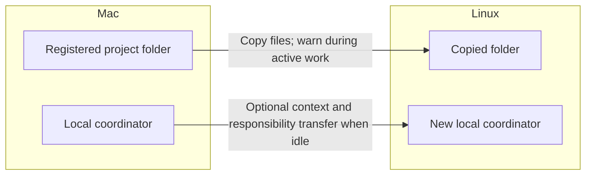

# Completed: portable project copy and coordinator recovery

Released SpecWithCode **1.0.69** from `052212d91161b5454722468817a0d70bead4af03` on 2026-10-22. [Copy fix #586](https://github.com/anton-abyzov/specwithcode-dev/pull/586) and [release #588](https://github.com/anton-abyzov/specwithcode-dev/pull/588) are merged. The user accepted the copy UI in this chat.

## Copy behavior

Unfinished work permits measurement and copying, with warnings for changing files. Coordinator-context transfer waits until the source is idle and the copied snapshot is current. A deferred transfer preserves the successful copy and offers an explicit retry.

The registered project root defines the copy. Selecting the umbrella includes its nested repositories and root context; selecting a child repository includes only that subtree. Arbitrary nested layouts are preserved. Destination suggestions resolve the destination machine's home. Default secret and rebuildable exclusions remain in effect.

Each machine runs its own local coordinator. Optional transfer carries project context and responsibility to a new local coordinator and makes the source assignment read-only. Processes, running provider sessions and provider credentials do not move.

## Coordinator error

The failure concerned conversation capacity, not the displayed account quota. The selected Codex GPT-6.1-Sol conversation had used **429,832 / 475,000 tokens**. The app reserved another **118,750 tokens** for response and tool work, leaving no handoff allowance. Provider, instance and model routing matched the coordinator selection.

Recovery fix #579 was already in main but absent from installed 1.0.68. Release 1.0.69 includes native compaction and bounded retry. The historical failure had aged beyond the automatic recovery window, so this acceptance check used the supported coordinator API to compact once and resend the exact original request once.

Live run 574 completed native compaction, reducing context to **104,099 tokens**. Run 575 answered the original request on the same Codex GPT-6.1-Sol model; context after the reply was **128,470 / 475,000 (27.05%)**. Neither run reported a quota error. The temporary scoped session was revoked and its removal verified. No prompt, reply text or credential is stored in these receipts.

## Verified delivery

| Surface | Result |
| --- | --- |
| M4 desktop | 1.0.69 running; Developer ID signature and notarization verified |
| M4, M1 and M3 services | 1.0.69, exact released source commit |
| Ministorm Linux service | 1.0.69, exact source, healthy systemd service; prior runtime retained |
| Ministorm CLI commands | Both updated to 1.0.69; original wrappers backed up; service PID unchanged |
| Real Mac-to-Linux copy | 6,210 files, 877,696,242 bytes, four repositories; Git/content checks, Undo and source preservation passed |
| Release server suite | 10,986 passed, zero failed, 30 skipped |
| Final focused suite | 246 passed across 17 files; 86.16% line / 80.94% statement coverage |
| Headless UI | Four light/dark desktop/mobile cases passed on the release candidate |
| Fresh review | Zero open findings; reviewed source differs from release only in four version fields |
| Increment | Seven tasks and five acceptance criteria complete; SpecWeave verify passed and CLI closure succeeded |

The release test checkout initially lacked Electron and the optional matching coverage provider. The unchanged desktop suite passed its bounded retry after runtime provisioning; final coverage passed with the existing isolated 5.0.1 provider. No production dependencies or shared toolchain were changed for these checks. The CLI's automatic coverage lookup did not find the scoped report; the actual report above was independently checked against the configured target.

M1/M3 desktop applications were not part of this installed-app verification. No permanent umbrella copy or live coordinator ownership transfer was performed; remote copy acceptance used isolated folders and removed them after Undo. External tracker closure hooks were disabled only during local increment closure and the original configuration was restored.

Detailed private receipts remain in this increment's `reports/`: `release-1.0.69-receipt.json`, `ministorm-update-1.0.69-receipt.json`, `ministorm-wrapper-refresh-1.0.69-receipt.json`, `coordinator-recovery-receipt.json`, `coordinator-post-recovery-20261022T050801Z.json`, `verify.md`, `coverage/coverage-summary.json` and `review.md`. Copy and UI evidence remains under `evidence/`.
