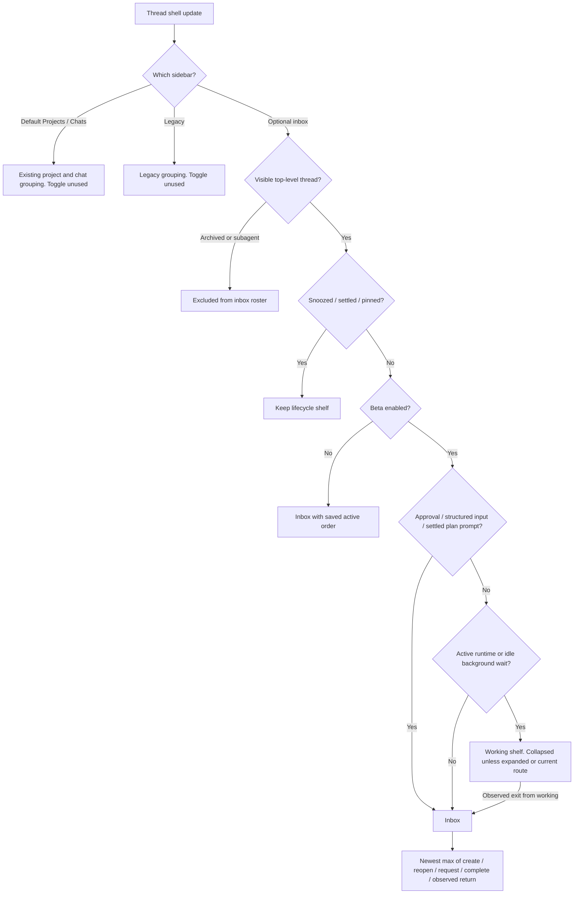

# Working section: useful, but narrower than the setting promises

On desktop/web, SpecWithCode implements a real Working shelf in its optional inbox sidebar. The default Projects/Chats sidebar and project Threads pane ignore this toggle. The folding and return logic works in focused tests, with gaps around stalled runs, sign-in, reported blockers, schedules and client reloads. No product code, real thread status, watcher or schedule was changed for this audit.

## Evidence boundaries

Source: detached app checkout `/Users/antonabyzov/Projects/github/specweave-umb/repositories/anton-abyzov/specweave-studio`, commit `bc3fabf56778cb4fe90a64e485bc8ada97e2695d`, clean when inspected. The SpecWeave checkout had unrelated changes, preserved. SpecWeave installed and npm stable were both `3.1.6`. App CLI reports `1.0.74`; this does not establish the service or desktop bundle version. `specweave-studio service status` reports `Status: not installed` in this invocation's service context, despite the running app database query endpoint being available. No restart or installation was attempted.

Live: sequential supported `specweave-studio db query` reads on October 23, 2026, approximately 2:04–2:08 AM EDT. The retained thread export contains 671 nonarchived local project threads. The classification fixture joins 272 of those to a latest app run; runless native subagent threads are omitted. Counts are a snapshot, not a fleet inventory or an atomic cross-table read. Tool listing initially returned 670 project threads; one was created during inspection. No inference of a lost thread follows from that difference.

Fixture: production pure helpers, existing unit tests and an isolated counterexample suite. The live classification is reconstructed from persisted rows through production background and classification helpers. It uses only the latest app run and omits older active-run selection, held-queue derivation, secret-request synthesis and runless native activity; it is not a captured installed sidebar. The screenshot supplied by the user crops out the switch and sidebar, so it does not establish the current client's toggle or sidebar mode. The automated report preview is headless. No installed UI transition was forced.

Evidence files: `/Users/antonabyzov/Projects/github/specweave-umb/.specweave/increments/1021-audit-working-section-behavior/evidence/live-classification.json`, `/Users/antonabyzov/Projects/github/specweave-umb/.specweave/increments/1021-audit-working-section-behavior/evidence/checks.json`, `/Users/antonabyzov/Projects/github/specweave-umb/.specweave/increments/1021-audit-working-section-behavior/evidence/focused-tests.log`, `/Users/antonabyzov/Projects/github/specweave-umb/.specweave/increments/1021-audit-working-section-behavior/evidence/model-tests.log`, `/Users/antonabyzov/Projects/github/specweave-umb/.specweave/increments/1021-audit-working-section-behavior/evidence/reader-tests.log`, `/Users/antonabyzov/Projects/github/specweave-umb/.specweave/increments/1021-audit-working-section-behavior/evidence/audit-tests.log`. All raw reads in `/Users/antonabyzov/Projects/github/specweave-umb/.specweave/increments/1021-audit-working-section-behavior/evidence` came through the supported service query command; no direct SQLite access or snapshot was used.

## The actual state flow

`/Users/antonabyzov/Projects/github/specweave-umb/repositories/anton-abyzov/specweave-studio/apps/web/src/components/AppSidebarLayout.tsx:337` chooses legacy, inbox, or default sidebar. `/Users/antonabyzov/Projects/github/specweave-umb/repositories/anton-abyzov/specweave-studio/apps/web/src/components/Sidebar.tsx:2806` removes archived threads and subagents, then partitions by snooze, settlement, pin and finally Working. `/Users/antonabyzov/Projects/github/specweave-umb/repositories/anton-abyzov/specweave-studio/apps/web/src/components/Sidebar.logic.ts:573` defines that visibility filter. `/Users/antonabyzov/Projects/github/specweave-umb/repositories/anton-abyzov/specweave-studio/apps/web/src/components/Sidebar.tsx:3061` keeps the currently open Working row visible even while the shelf is collapsed. A status-driven move never navigates to another conversation.

## Exactly what counts as Working

`/Users/antonabyzov/Projects/github/specweave-umb/repositories/anton-abyzov/specweave-studio/packages/client-runtime/src/state/threadInbox.ts:20` is the shared folding predicate. Approvals and `hasPendingUserInput` escape first. Runtime preparing, queued, starting, running and waiting fold; runtime idle also folds. A proposed plan escapes only in plan mode once its latest run is settled and is no longer the active run. Completed, failed, interrupted, cancelled and rolled-back runtimes otherwise stay in the inbox. Unread, selected, stalled, reported-blocker, held-queue and sign-in state are absent from this predicate.

Runtime idle here normally means a completed root run still has work that will wake it. `/Users/antonabyzov/Projects/github/specweave-umb/repositories/anton-abyzov/specweave-studio/packages/client-runtime/src/state/models.ts:207` converts such shells to idle, preserving failure precedence. `/Users/antonabyzov/Projects/github/specweave-umb/repositories/anton-abyzov/specweave-studio/packages/shared/src/orchestrationV2PendingBackgroundWork.ts:70` says commands alone do not hold completion; subagents, monitors, workflows and generic background tasks do. This distinction applies after the foreground run settles. A still-running attached shell command keeps the foreground run active and can still delay an app update. Folding changes no updater quietness rule.

The server derives the roster from the active provider thread, unfinished command/tool/subagent items, and PR watches. Active foreground work suppresses that post-turn roster. A watch with no root run still contributes a monitor; rolled-back latest runs reject the old roster. Persistent dynamic tools are excluded. See `/Users/antonabyzov/Projects/github/specweave-umb/repositories/anton-abyzov/specweave-studio/packages/shared/src/orchestrationV2PendingBackgroundWork.ts:227` and `/Users/antonabyzov/Projects/github/specweave-umb/repositories/anton-abyzov/specweave-studio/apps/server/src/orchestration-v2/ProjectionStore.ts:1489`.

A scheduled job is not one of these sources. A future dispatch can exist while its associated thread looks completed or Idle. This is a boundary of the current feature, not evidence that the scheduler is broken. The release schedule remains enabled for October 23 at 6:26 AM EDT.

Native subagents can have no app run; their root node supplies activity status (`/Users/antonabyzov/Projects/github/specweave-umb/repositories/anton-abyzov/specweave-studio/apps/server/src/orchestration-v2/ProjectionStore.ts:1416`). Their rows still do not become inbox rows: app-owned and native subagent lineage is filtered out and exposed through parent Agents/project surfaces. The project pane deliberately distinguishes direct workers from nested subagents (`/Users/antonabyzov/Projects/github/specweave-umb/repositories/anton-abyzov/specweave-studio/apps/web/src/studio/projectWorkspaceModel.ts:103`).

The React Native mobile inbox shares this predicate through `/Users/antonabyzov/Projects/github/specweave-umb/repositories/anton-abyzov/specweave-studio/apps/mobile/src/features/threads/threadListV2.ts:720` and owns a separate device-local preference. This audit did not test mobile or physical iOS behavior; the desktop toggle is not a fleet-wide setting.

## What the live examples prove

| Example | Stored evidence | Production-helper result | Interpretation |
|---|---|---|---|
| specweave coordinator | Latest captured run completed; five retained watches: #477, #628, #629, #630, #631; four unfinished subagent items | Runtime idle; inbox Working predicate true; project grouping helper Idle | Monitoring survives between turns. The two surfaces disagree on its label. Coordinator is the main project conversation, not one of its worker cards. |
| Complete project work and disk audit | Completed app run plus unfinished subagent `Finish 0734 0748 0752 0850 0854` | Runtime idle; Working predicate true; project group Idle | The background roster holds completion. This proves a retained item, not that the child is currently progressing. |
| Activity diffs and compact output (`activity-code-diffs-compact-output-20261023`) | Completed run in the captured run export; two provider-roster workflow entries | Runtime idle; Working predicate true; project group Idle | A workflow wait qualifies. The worker can resume after this snapshot. |
| Update CLIs across connected machines | Captured app run running; delegated child lineage | Working predicate true; project group Working; excluded from top-level inbox | Active work is visible in the project's worker surface, independent of this toggle. |
| Prepare Mac and mobile release | Captured latest run completed; no background roster or watch in its captured records | Working predicate false; project group Idle | Its release ownership and future scheduled dispatch do not require a running turn. No duplicate release was started. |
| Cursor support and settings design | Completed run and latest report asking for an external user action; unsettled | Working predicate false; project group Waiting on you | Reported blockers work in the project pane. The inbox classifier itself does not give them a dedicated input status. |
| Audit follow-ups: contrast and pickers | Latest run failed, explicit settled override | Working predicate false; project group Resolved | Explicit settlement is independent of run outcome. “Resolved” is not proof the failed work passed. |
| Stuck Working status | Historical thread completed and explicitly settled | Working predicate false; project group Resolved | Its historical repair is not a current active or stalled example. |

No live pending structured approval or user-input request appeared in the retained request query. No live blocker-plus-monitor combination appeared in the reconstructed set. Those combinations were tested as isolated counterexamples, not represented as live failures.

The similarly titled `activity-diffs-ultracode-resume-20261023` is a different thread: its captured completed run has a report blocker and classifies Waiting on you. The workflow example above is specifically `activity-code-diffs-compact-output-20261023`. Stable full IDs and all captured inputs are retained in the live classification evidence.

## Concrete discrepancies and scoped fixes

1. **The control is available where it has no effect.** `/Users/antonabyzov/Projects/github/specweave-umb/repositories/anton-abyzov/specweave-studio/apps/web/src/components/settings/SettingsPanels.tsx:2421` displays the setting without an inbox-mode dependency; only `/Users/antonabyzov/Projects/github/specweave-umb/repositories/anton-abyzov/specweave-studio/apps/web/src/components/Sidebar.tsx:2411` consumes it. Neither default sidebar nor project pane consumes it. Recommendation: label it “Working section in the inbox sidebar” and explain or gate its inbox dependency. If the intended scope is the project Threads pane, plan that separately; toggling this setting cannot currently test it.

2. **Stalled work remains folded.** The existing health helper can return stalled, and the inbox row renders “No activity” (`/Users/antonabyzov/Projects/github/specweave-umb/repositories/anton-abyzov/specweave-studio/apps/web/src/components/Sidebar.tsx:1286`), but the partition never reads health. An inactive collapsed row can hide that warning. The overview still has its own Needs you handling (`/Users/antonabyzov/Projects/github/specweave-umb/repositories/anton-abyzov/specweave-studio/apps/web/src/studio/overviewModel.ts:54`), so this is not total loss of the alert. Recommendation: share one attention predicate and let stalled work escape the shelf. Counterexample confirmed; no live stalled-run claim made.

3. **Some “needs you” states are missing from the fold boundary.** `reportedBlocker` plus runtime idle stays Working even though `projectThreadGroup` says Waiting on you. A pending `auth_refresh` is interpreted as sign-in by `threadAwaitingPerson` but is neither an approval nor `hasPendingUserInput` in `presentThreadShell`, so an active run stays folded. A held queue with remaining background work has the same split. Recommendation: include sign-in, a current report blocker and held queues in the shared attention predicate, with explicit active-run precedence. Counterexamples cover blocker and sign-in; held queue follows the same source omission and was not separately exercised.

4. **Monitoring can read Idle in the project pane.** `/Users/antonabyzov/Projects/github/specweave-umb/repositories/anton-abyzov/specweave-studio/apps/web/src/studio/projectWorkspaceModel.ts:56` checks active runtime, not idle-with-background. A live coordinator and two workers provide persisted roster examples of this distinction. Recommendation: keep one shared classification for busy, monitoring and attention, while retaining each surface's layout. This does not require a sidebar redesign.

5. **Return-to-top is only partly durable.** `/Users/antonabyzov/Projects/github/specweave-umb/repositories/anton-abyzov/specweave-studio/packages/client-runtime/src/state/threadInbox.ts:115` keeps observed returns in a module-local map. Approval requests or background completion that the client sees get a local `Date.now()` stamp. A fresh window, reload, toggle off/on, or temporary removal from the list loses that stamp. The next observation establishes a baseline and cannot recover the return event. Normal completion still sorts by persisted completedAt. Recommendation: either qualify the copy or persist a server attention-transition timestamp, separate from unread/visit state. The reload counterexample is reproducible with production helpers.

## Ordering, unread and reader intent

Beta on: Working sorts newest by the latest human-authored message, or creation time for agent-launched threads; old servers without that field fall back to latest run request. Background wakes do not reorder the Working shelf when the authored stamp exists (`/Users/antonabyzov/Projects/github/specweave-umb/repositories/anton-abyzov/specweave-studio/packages/client-runtime/src/state/threadInbox.ts:75`). Inbox sorts descending by the maximum of creation, unsettledAt, latest request, latest completion and local observed return (`/Users/antonabyzov/Projects/github/specweave-umb/repositories/anton-abyzov/specweave-studio/packages/client-runtime/src/state/threadInbox.ts:47`). Stable ID/environment tie-breaks handle simultaneous returns. This intentionally promotes status transitions, so the beta is an exception to the previous no-background-jumping policy.

Beta off: the observer resets and the saved active ordering returns (`/Users/antonabyzov/Projects/github/specweave-umb/repositories/anton-abyzov/specweave-studio/apps/web/src/components/Sidebar.tsx:2873`). Turning the beta on ignores, but retains, manual inbox placement. It changes presentation only; it does not stop work, cancel monitors, mark anything read or settle it. Pins, snoozed and explicitly settled rows retain their lifecycle shelves. Only inbox threads fold.

Unread is separate: a completion is unseen only if completedAt is newer than lastVisitedAt; never-visited historical threads count as read (`/Users/antonabyzov/Projects/github/specweave-umb/repositories/anton-abyzov/specweave-studio/apps/web/src/components/Sidebar.logic.ts:776`). Reading a thread does not remove its monitor. A root completion can be unread while its monitor keeps it in Working. The row visually recedes unless active/selected; this styling is separate from shelf placement (`/Users/antonabyzov/Projects/github/specweave-umb/repositories/anton-abyzov/specweave-studio/apps/web/src/components/Sidebar.logic.ts:967`).

The conversation scroll follower is separate again. It preserves a reader's place and pauses on intentional upward input; own-send, Jump to latest, or returning to the end resumes following. Section movement does not itself call navigation or scroll-follow code. `/Users/antonabyzov/Projects/github/specweave-umb/repositories/anton-abyzov/specweave-studio/apps/web/src/components/studio/useConversationFollow.ts:90` and `/Users/antonabyzov/Projects/github/specweave-umb/repositories/anton-abyzov/specweave-studio/apps/web/src/lib/readerScroll.ts:1` implement this. Focused follower tests were rerun; this is not live physical reader-intent acceptance.

## Watch transitions and the old stuck-run report

PR watches are durable link metadata. The reactor wakes the owning thread on relevant host changes and preserves the watch between wakes; the roster then holds it at idle/Waiting. The current source uses a two-minute sweep with quiet rereads (`/Users/antonabyzov/Projects/github/specweave-umb/repositories/anton-abyzov/specweave-studio/apps/server/src/orchestration-v2/PullRequestWatchReactor.ts:44`). Merged, settled, archived/deleted or subagent-ineligible watches terminate; closed/unreadable paths can wake with an explanation. See `/Users/antonabyzov/Projects/github/specweave-umb/repositories/anton-abyzov/specweave-studio/apps/server/src/orchestration-v2/PullRequestWatchReactor.ts:307` and `/Users/antonabyzov/Projects/github/specweave-umb/repositories/anton-abyzov/specweave-studio/apps/server/src/orchestration-v2/PullRequestWatchReactor.ts:420`. Retained watches are evidence of subscription state, not proof the latest host check ran successfully or that every callback was delivered.

The earlier [Stuck Working status](studio://thread/thread%3Adelegated-task%3Acommand%253Amcp%253A6bf858db-464e-45c2-bf7e-7a5e238b5ce7%253Adelegate-task%253Astuck-working-status-2026-10-15-0812) report, final item at position 556, blamed a Grok turn that posted an answer without ending and a cached client Working state. It described watchdog/health fixes and explicitly lacked final headless screenshots. That is historical testimony, not proof of this installed build. Current source still distinguishes runtime health from shelf placement, which is why a stalled pill alone does not make the beta promise true.

The four requested project knowledge notes were read: sidebar stable ordering, blocker parsing, update quietness and reader follow intent. Their old version numbers were not treated as current installed proof. A stale **Blockers:** report persists until a later user/follow-up message supersedes it (`/Users/antonabyzov/Projects/github/specweave-umb/repositories/anton-abyzov/specweave-studio/apps/server/src/orchestration-v2/ProjectionStore.ts:1716`); several historical rows still contain agent-settleable “blockers.” This audit did not send continue or clear any of them.

## Auto-settlement is a separate boundary

The beta never auto-settles anything. The server sweep is independently controlled by `sidebarAutoSettleOnMerge` and project overrides. `/Users/antonabyzov/Projects/github/specweave-umb/repositories/anton-abyzov/specweave-studio/apps/server/src/orchestration-v2/ThreadSettlementService.ts:117` excludes pinned, opted-out, explicitly overridden, pending-request, reported-blocker, active-run and completion-holding-background threads. A recent unadopted user turn also protects the thread.

`/Users/antonabyzov/Projects/github/specweave-umb/repositories/anton-abyzov/specweave-studio/apps/server/src/orchestration-v2/ThreadResolutionPolicy.ts:25` requires every relevant visible PR to be merged, not draft, checks passing and review approved. Each observation must have coherent merge/update/observe times; the latest merge must be at or after the latest human-authored message or thread creation. Missing evidence stays active. The old inactivity-days setting is retained for compatibility and does not finish work (`/Users/antonabyzov/Projects/github/specweave-umb/repositories/anton-abyzov/specweave-studio/apps/server/src/orchestration-v2/ThreadSettlementService.ts:151`). A sequence fence rechecks live state before applying settlement (`/Users/antonabyzov/Projects/github/specweave-umb/repositories/anton-abyzov/specweave-studio/apps/server/src/orchestration-v2/Orchestrator.ts:10692`).

These PR snapshots have no exact-head QA receipt. Auto-settlement proves the policy accepted host observations, not tests on the exact SHA, increment closure, deployment, installed behavior or public availability. No auto-settlement was triggered for this audit. Server setting values were not read from private configuration, so the audit does not assert that automatic settlement is enabled in the live environment.

## Verification

- Existing focused suite: 220 tests passed across folding/ordering, background roster and auto-settlement service.
- Existing project model suite: 60 tests passed. The supplied second filename did not match a test file, so it adds no coverage.
- Isolated audit suite: 11 tests passed, including assertions that reproduce the discrepancies above and classify persisted examples. Passing counterexample assertions document defects; they do not mean the defects are fixed.
- Conversation follow suite: 16 tests passed; output recorded in `/Users/antonabyzov/Projects/github/specweave-umb/.specweave/increments/1021-audit-working-section-behavior/evidence/reader-tests.log`.
- No product changes, production build, live status mutation, watcher cancellation or schedule mutation. Research findings require a separate implementation scope.

Recommended first change: make the control's scope truthful, then define one shared needs-user predicate for folding and project grouping. Preserve the current ordering and reader-follow behavior outside those specific boundaries.

## Closure receipt

Research increment 1021 completed after verify and independent review PASS. Configured external tracker hooks reported missing JIRA/ADO credentials, with zero user stories and zero items closed. This does not block local research closure. Exact errors and the canonical review-copy note are retained in `/Users/antonabyzov/Projects/github/specweave-umb/.specweave/increments/1021-audit-working-section-behavior/evidence/closure.md`.
