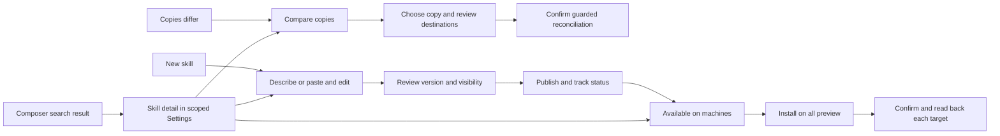

# 1248 Manage skills across machines

## Problem
Skills can be discovered in the composer but cannot be managed directly from a result. The detail sheet presents long raw Markdown descriptions, repeats shared paths and mixes local version, registry version and agent readiness. Creating and distributing a skill requires finding separate controls. Anton requested one coherent create, inspect, compare, publish and install flow.

## Scope
Follow-up to completed 1209 and merged PR #1430 (`c8192f8c5599ff9f19d9c636cfd20018293e5ceb`). Source brief: `/Users/antonabyzov/Projects/github/specweave-umb/.specweave/increments/1209-create-publish-and-apply-skills-in-specwithcode/follow-up.md`.

In: Markdown detail, summaries and usage guidance, grouped agent paths, composer deep links, differing-copy comparison and explicit resolution, existing-skill editing/version/publication, New skill, fleet availability and Install on all. Reuse 1209 authoring and publication; retain counts/filter behavior. Include the tracked ancestor-root refusal hardening. Out: automatic publication, automatic conflict resolution, plugin bundle publishing, suggestions, new model spend, live account publication or unapproved fleet mutations during verification.

**Checkout gate:** planning only until the current holder explicitly releases the shared checkout. PR #1138 is already merged (`dc5bfc738e`). Queue: the 1247 pipeline worker holding the shared checkout for PR #1449, then the MIT cutover owner, then 1248. The cutover owner will explicitly message this thread on release. Ask the current holder again before branching; check clean status and no remaining writers. No worktrees, clones, stash, branch switch, fetch, reset or app source edits while waiting. Only authorized implementation path: `/Users/antonabyzov/Projects/github/specweave-umb/repositories/anton-abyzov/specwithcode-dev`. After cutover, the canonical repository is `anton-abyzov/specwithcode`, branch `main`, and this shared checkout origin will point there. Verify that remote and fresh main after the explicit release before creating `feat/1248-skill-management` there. Never open a new PR against `specwithcode-dev`; it is being archived.

## Acceptance Criteria
- [ ] AC-01: Every composer skill result is keyboard- and pointer-accessible and opens the corresponding Skills detail with machine, agent, project and thread-folder context preserved. Copies differ opens Compare directly. Search and unsent composer text survive returning; stale, missing or inaccessible destinations show an explicit state, never another machine's skill.
- [ ] AC-02: The detail renders safe Markdown including inline code, links and line breaks, shows a short source-derived summary and When to use, and expands full description/body through Show more/Instructions. It never invents usage instructions or makes a model call on opening. Local file version, registry publication state and loading readiness are distinguished. Agents sharing the same machine/scope/path display that path once and retain independent toggles.
- [ ] AC-03: Compare displays each distinct copy's machine, path, scope, agent membership, version and content hash, with readable text diffs. Choose this copy previews exact destinations and changes before applying. A changed source or destination invalidates the preview; protected/plugin-managed copies are refused with an actionable explanation. Cancellation performs no writes.
- [ ] AC-04: Edit creates a resumable draft from the selected copy, permits an explicit version bump under metadata.version, previews exact content/account/visibility, and reuses 1209's publication statuses and duplicate/uncertain-retry handling. New skill is visible in Settings Skills and opens describe or paste, agents and scope, review/publish, apply. No generation, publication or install happens merely by navigating.
- [ ] AC-05: Available on shows the actual discovered machine names, observed versions and agent availability for the local machine and linked fleet, including M1, Ministorm and Duo when present. Missing, offline, permission-denied and stale/unknown are distinct; unknown is never reported absent or installed. Reads are bounded and scoped; refresh provides observation time.
- [ ] AC-06: Install on all opens one preview with a pinned registry identity/version/hash, machines, agents and user/project scope. Explicit confirmation installs or updates selected eligible destinations through guarded fleet commands. The destination rechecks grants, paths and expected hashes. Unreachable/incompatible/ungranted machines remain visible with reasons. Per-target receipts survive partial failure; Retry failed does not repeat verified successes. Readback distinguishes installed from ready for current/next session. No active session is restarted or message sent.
- [ ] AC-07: Light/dark at 1440px and 390px have readable contrast, no page overflow and reachable controls; narrow diffs use unified layout. Headless before/after screenshots and keyboard checks cover detail, compare, new skill and fleet partial results. Focused behavior/permission tests, production builds, fresh review and applicable CI pass; closure records proof limits.
- [ ] AC-08: Publishing on an unavailable filesystem root terminates with a clear refusal rather than looping, with an offline-UNC/root-fixpoint regression.

## Approach
### Inspected baseline
Read immutable Git objects at the merged 1209 SHA without changing the app checkout. `ComposerSkillsPopover.tsx` already builds settings search with machine/project/checkout/agent and skillCwd/skillThread/skillContext. Reuse that resolver rather than derive machine labels as identities. `ProjectSkillsSettings.tsx` already accepts detail focus and owns the sheet; its description is currently plain SheetDescription. `ProjectSkillFleetPush.tsx` offers Push to machines with manually selected targets. `ProjectSkillsFleet.ts` already validates registry versions and fleet destinations. Its current target contract has user/project scope but no selected-agent list or expected-content preview; add these at the existing guarded boundary rather than build a second installer. Re-read after PR #1449 and the MIT cutover finish.

### Interaction design
Use the current Settings sheet, semantic colors, typography and button variants. At wide widths keep the list visible beside a comfortably sized detail; at narrow widths use the existing full-width sheet. Header: skill name, source/version, one short summary and an overflow menu. Below it: When to use, Show more, then Overview / Compare (only when relevant) / Instructions. A warm warning link says Copies differ; do not hide it in a tooltip. Use normal text labels such as Local copy, Published 1.3.0, Changed locally, Loaded now, Next session, and Unavailable instead of raw `ok`.

When explicit usage text exists, show it. Otherwise display an honest "No usage guidance provided" with Edit; use a deterministic excerpt of the original description as the summary. Full text remains accessible. Markdown is presentation only: reject unsafe URLs/raw HTML, avoid remote image loads and preserve literal code. Long paths wrap with copy controls and a full-path accessible label. Group only identical machine/scope/canonical-path copies; never collapse different paths merely because their contents match. Group toggles show shared-file implications before mutations.

Available on is a compact wrapping row of machine chips below usage text. Selecting a chip opens that machine's agent/version breakdown without losing the selected skill. Install on all sits beside the section heading. It opens a review sheet, not an immediate blind write. Default all eligible linked machines and compatible agents in the selected scope; list exclusions and allow deselection. Local unpublished skills offer Publish to distribute. Private publication remains private; targets without registry access show a refusal, never a public fallback or copied credential.

Compare shows two copy selectors with provenance, a side-by-side diff on wide screens and unified diff on narrow screens. Choose this copy means use its exact bytes for an explicit reconciliation preview; publication remains a separate action. Same-version/different-hash conflicts remain conflicts. Edit and Publish reuse the authoring sheet; generated drafts retain the chosen provider, and manual paste needs no provider.

### Implementation and safety
Keep typed requests and environment-scoped commands at existing boundaries. New copy/body reads resolve inventory identities server-side, with size limits and allowed-root checks; never accept an arbitrary path supplied by a URL. Pin preview inputs to source and destination snapshots. Existing fleet installation must be extended at its destination executor as needed for agent selection, stale checks and receipts. Bound concurrency, preserve target isolation and avoid background retries of uncertain writes. Reuse the existing diff/Markdown components after source inspection; do not add imports to ws.ts. Details and operation state are distinct from current session skill-use evidence.

## Decisions
### Asked
- Anton authorized the full follow-up and explicitly required shared-checkout sequencing, no worktrees, and asking the holder before branching.
### Defaulted
- One detail sheet with focused views; no separate management application.
- Summaries are deterministic/source-derived; missing usage guidance is explicit.
- Install on all means preview all eligible targets, then one explicit confirmation, with exclusions visible and failed-only retry.
- Unpublished local copies must be published explicitly before registry-based fleet distribution. No silent upload or visibility change.
- Plugin-managed files are inspectable, but incompatible edits route to their owning plugin workflow instead of corrupting its bundle.
### Open
- Operational dependency only: the 1247 pipeline worker finishes PR #1449, then the MIT cutover owner explicitly releases the checkout to this thread. Verify origin points to `anton-abyzov/specwithcode` and use `main`; confirm the release owner after cutover. No product decision is waiting on Anton.

## Tasks
All app paths below are relative to `/Users/antonabyzov/Projects/github/specweave-umb/repositories/anton-abyzov/specwithcode-dev`. File allocation is planned, not an active claim; three implementation lanes share this checkout and branch with disjoint files. T-03 and T-04 coordinate with the T-02 contract owner before consuming new RPCs; T-03 owns all Settings composition. Each lane stages only its explicit files. Confirm downstream route and fleet-executor paths before claiming T-02 and append exact paths to this spec first.

### T-01 Reconcile ownership and freeze the implementation design
- AC: AC-01, AC-07 | Files: spec.md | Test: verify explicit holder release, clean shared checkout, current remote/main and existing Skills owner boundaries; baseline capture is assigned to T-05 before T-03 UI edits

### T-02 Extend scoped copy and fleet contracts and server actions
- AC: AC-03, AC-05, AC-06, AC-08 | Files: packages/contracts/src/projectSkills.ts, packages/contracts/src/projectSkillsActions.test.ts, packages/contracts/src/projectWorkspaceRpc.ts, packages/contracts/src/clientRpcPermissions.ts, packages/client-runtime/src/state/projectWorkspace.ts, apps/server/src/project/ProjectSkillsActionsRpc.ts, apps/server/src/project/ProjectSkillsActions.ts, apps/server/src/project/ProjectSkillsActions.test.ts, apps/server/src/project/ProjectSkillsFleet.ts, apps/server/src/project/ProjectSkillsFleet.test.ts, apps/server/src/project/SkillPublishingAdapter.ts, apps/server/src/project/SkillPublishingAdapter.test.ts | Test: from apps/server run node ../../node_modules/vite-plus/bin/vp test run src/project/ProjectSkillsActions.test.ts src/project/ProjectSkillsFleet.test.ts src/project/SkillPublishingAdapter.test.ts; exercise RPC grant refusal, stale copy preview, partial fleet result and repeated-apply idempotency

### T-03 Build scoped navigation, readable detail and copy comparison
- AC: AC-01, AC-02, AC-03 | Files: apps/web/src/components/chat/ComposerSkillsPopover.tsx, apps/web/src/components/settings/ProjectSkillsSettings.tsx, apps/web/src/components/skills/SkillDetailPanel.tsx, apps/web/src/components/skills/SkillCopyCompare.tsx, apps/web/src/components/skills/SkillDetailPanel.test.tsx, apps/web/src/components/chat/ComposerSkillsPopover.test.tsx | Test: from apps/web run node ../../node_modules/vite-plus/bin/vp test run src/components/skills/SkillDetailPanel.test.tsx src/components/chat/ComposerSkillsPopover.test.tsx; keyboard/deep-link context and unsafe-Markdown regressions

### T-04 Connect New skill, edit/version/publish and fleet availability
- AC: AC-04, AC-05, AC-06 | Files: apps/web/src/components/skills/SkillAuthoringSheet.tsx, apps/web/src/components/skills/SkillAuthoringSheet.test.tsx, apps/web/src/components/skills/SkillAvailability.tsx, apps/web/src/components/skills/SkillAvailability.test.tsx, apps/web/src/components/settings/ProjectSkillFleetPush.tsx | Test: from apps/web run node ../../node_modules/vite-plus/bin/vp test run src/components/skills/SkillAuthoringSheet.test.tsx src/components/skills/SkillAvailability.test.tsx; verify publish-resume, scope/agent preview, unknown machine and retry-failed behavior

### T-05 Verify design and deliver the follow-up PR
- AC: AC-07 | Files: apps/web/tests/skill-management/vite.config.ts, apps/web/tests/skill-management/index.html, apps/web/tests/skill-management/main.tsx, apps/web/tests/skill-management/verify.mjs, docs/studio/skills.md | Test: build fixture and headless verify; focused suites and web/server production builds; Sonnet 5.5 fresh review and applicable CI. Store before/after evidence under /Users/antonabyzov/.specwithcode/m4/evidence/1248-skill-management/. Report exact released clicks separately from installed availability. Coordinate the current merger and release dispatcher after MIT cutover.

### T-06 Verify and close 1248
- AC: AC-07 | Files: evidence.md | Test: specweave verify 1248; fresh-context closure review; specweave complete 1248. Preserve live-provider, private-registry and real-fleet proof limits unless explicitly exercised with authorization.

## Released implementation slot, November 6, 2026

The cutover owner explicitly released the shared checkout to 1248. Fresh check: clean, main `072265ee0093a9744d4cbcbf774ceb14b46b22d9`, origin `https://github.com/anton-abyzov/specwithcode.git`. Created `feat/1248-skill-management` from fetched origin/main; no private-history merge or worktree. SpecWeave pickup reports umbrella Git metadata; app branch evidence is the explicit app Git check.

T-02 additionally owns `apps/server/src/fleet/fleetSkills.ts`, `apps/server/src/fleet/fleetSkills.test.ts`, `apps/server/src/studioFleetHttp.ts`, `apps/server/src/studioFleetHttp.test.ts`, `packages/contracts/src/studioFleet.ts`, and new `apps/server/src/project/ProjectSkillCopies.ts` / `ProjectSkillCopies.test.ts` if extracting bounded copy actions. Extend only required existing service composition, no ws.ts imports.

T-03 additionally owns `apps/web/src/routes/settings.skills.tsx`, focused Skills detail logic modules/tests under `apps/web/src/components/skills/SkillDetail*` and `SkillCopy*`, and T-05's `apps/web/tests/skill-management/` fixture files. It captures the baseline before changing UI. T-04 additionally owns `apps/web/src/components/skills/SkillApplyPanel.tsx` and authoring seeding helpers/tests under `apps/web/src/components/skills/skillAuthoring*`. New skill and edit callbacks are wired in Settings by T-03 using T-04's exported props. Public fixtures and docs use fictional machine names and paths, not private evidence.

### Integration allocation
T-02 additionally owns `apps/server/src/observability/RpcInstrumentation.ts` for the new typed RPC classification, `packages/contracts/src/skillAuthoring.ts`, `packages/contracts/src/skillAuthoring.test.ts`, `apps/server/src/project/SkillAuthoringService.ts` and `apps/server/src/project/SkillAuthoringService.test.ts` to preserve arbitrary existing frontmatter during editing. T-03 additionally owns `apps/web/src/components/settings/ProjectSkillsSettings.test.tsx` for copy-read mocks and scoped navigation regression. T-04 owns seed/parser/UI roundtrip tests for the same preservation. Existing nonstandard frontmatter must not be silently dropped or force normal users out of the editing flow.

Checkout queue after 1248: 1246 signing, then Keep machine name on narrow composer. Send 1246 explicit release only once all edits are committed/pushed, checks/review no longer need local mutations, and checkout is clean; notify the machine-name thread afterward.

T-02 also owns `apps/server/src/project/SkillPublishingService.ts` and `apps/server/src/project/SkillPublishingService.test.ts`, where SKILL.md serialization actually occurs, to preserve validated source frontmatter through publication.

### Review repair and returned checkout
On November 6, 2026, the 1249 owner explicitly returned the clean shared checkout at `807b1e35c1cbfe50ae6c7fc2c7ebd8cf744c5472` on `feat/1248-skill-management`. Leave their empty `feat/1249-overview-redesign` ref untouched. Repair H1/H2 and M1-M4 from `/Users/antonabyzov/.specwithcode/m4/evidence/1248-skill-management/review-807b1e35c1.md`, rerun focused checks, then fresh review before push/PR delivery. Queue after1248:1246, machine-name thread, Worker card task line, then1249. Last holder before1249 sends its explicit release.
