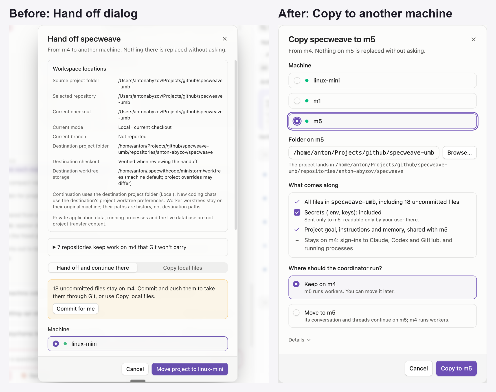

# One Copy to another machine flow

Handoff, "continue there" and "copy local files" were one copy engine with one switch: where the coordinator runs. The app now shows exactly that: one menu item, one dialog, one question.

## The flow (option A of [mockups](mockups.html))

1. Project menu: **Copy to another machine…** (replaces Add to another machine, Move to another machine and Sync to {machine}).
2. One screen: machine, **Folder on {machine}**, **What comes along**, **Where should the coordinator run?**, closed **Details**.
3. What comes along: all files including uncommitted ones; **Secrets (.env, keys): included**, a checked line, with Show listing each file; project goal, instructions and memory; "Stays on m4: sign-ins to Claude, Codex and GitHub, and running processes".
4. Coordinator: **Keep on m4** (default, m5 runs workers, button "Copy to m5") or **Move to m5** (its conversation and threads continue on m5, button "Copy and move to m5").
5. Details: Workspace locations, worktree notes, How files travel (Copy everything / Clone clean repositories from Git / Git only) and Let me choose file types first.

## What Add, Move and Hand off mean now

| Before | Now |
|---|---|
| Add to another machine | Copy to another machine, Keep coordinator |
| Move to another machine / Hand off and continue there | Copy to another machine, Move coordinator |
| Copy local files | Copy to another machine, Keep coordinator (same thing) |
| Sync to {machine} | Copy to another machine again; only changed files move |
| Move to {machine} (already linked) | Move coordinator to {machine}: copies nothing |
| Git-only handoff | Details > How files travel > Git only; always moves the coordinator, uncommitted work shown as one line with Commit for me |

Composer "Run on > Add to another machine…" is unchanged (it starts a thread, not a project copy). Wording matches PR 350: "Coordinator here" / "Workers only".

## Secrets

- Included by default and visible; one click leaves them on the source, and the review says so. No second confirmation.
- The current choice is sent to the source before every approval, including an empty list that withdraws earlier staged files.
- The choice survives remeasure, Change setup, close and reopen, and the background one-click watcher.
- A copy saved before this update (no saved choice) keeps secrets on the source.

## Review

GPT-6.1 Sol (Codex, xhigh) on linux-mini, 11 rounds; round 11 found nothing left. 18 findings fixed, each with a test confirmed failing without its fix: see [review.md](review.md).

Follow-up (server and wire, out of scope): staged secrets have no revision, so two windows sending at the same moment can still interleave at the source within one round trip. Same race exists on main between two dialogs. Noted on 1325.

## Evidence

- Screens: [setup light](after-setup-light.png), [setup dark](after-setup-dark.png), [Move chosen](after-setup-move.png), [Details](after-setup-details.png), [review with secrets](after-review-secrets.png), [Git only](after-git-only.png).
- Tests: 236 in the 15 copy-flow web suites; headless folder-copy (24 cases), machine-folders and machine-handoff fixtures.
- CI: required checks green on `1afe272e2` after one rerun (unrelated `mergedCloneSweep.test.ts` lock-file flake).
