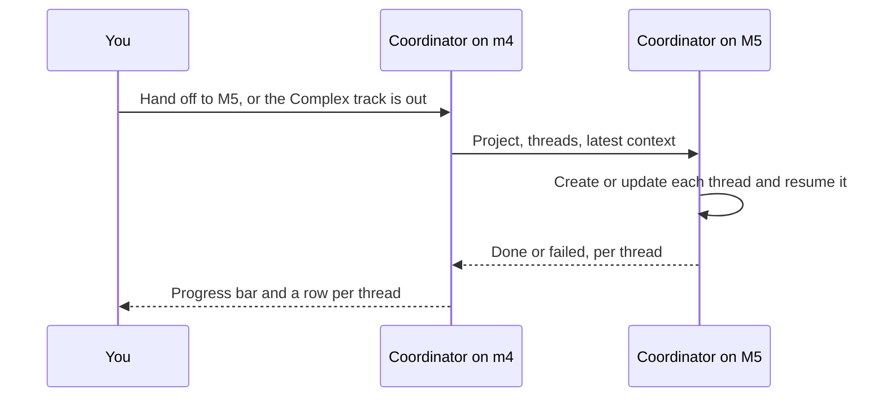

# Equal coordinators, and a handoff you can see

November 19, 2026. This is a proposal. It is not accepted, and nothing in it is to be built until Anton says so after the Muse review.

## Why M5 has no "Extra coordinator" label

Nothing is missing on M5. The label is a warning, and M5 did not trip it.

The shipped menu (`copyRoles` in `apps/web/src/studio/projectDomain.ts` on `origin/main`) gives a row one state. "Extra coordinator" is only the state `also-main`: a linked machine that still has its own active coordinator, and that is not the one the link treats as the project's coordinator. The dialog in the screenshot is that state. It says linux-mini also runs a coordinator for "specweave", and the project's coordinator is on m4 (`ExtraCoordinatorFix.tsx`).

M5 is a member of the same project (environment `644195cc`, project `aed6d625`). Its row has no role word. That is the state `copy`: it does not still run a second live coordinator. Linking makes the joining machine give way. An active coordinator with no predecessor, which is what "Start a coordinator here" left behind on m1, is what gets the label. linux-mini still has one. M5 does not.

The project name in that dialog is easy to miss. It sits in the sentence as a bare word, "specweave", with no icon and no quotes.

## What changes

Every machine that has the project runs its own coordinator. They are equals. No main, no extra, no Fix, no Unlink to make one give way. Typing on a machine talks to that machine's coordinator.

A handoff does not move a role. m4's coordinator sends one message to M5's coordinator: the project name, the threads, and the latest context. M5's coordinator creates or updates those threads and resumes them. It answers done or failed per thread. The window shows the progress view below for every handoff.

## Two ways it starts

1. You press Hand off, or you tell the coordinator, for example "hand off to M5". Closing the laptop does not start it. Sleep handoff stays off.
2. The usage-limit setting already in the app. `providerLimitSwitchAtPercent` defaults to 99 (`packages/contracts/src/settings.ts:1591`), about 1% left. Before any machine change, the thread stays here and walks its track (`decision_model_tracks.md`): the same model on its other sources, then the next model on that track. Daily is Opus 5.5, Sonnet 5.5, GPT-6.1 Sol, then GPT-6 Luna. Complex is Fable 5.2, then GPT-6 Astra. Review is Muse Wonder Full, then GPT-6.1 Sol, then Gemini 4 Carbon. Only when that track has no model left with tokens on this machine, and another machine still has tokens on the same track, those threads hand off. The view says why, for example "Complex track out of tokens on m4".

A provider instance still has to fail on its own. A handoff is not forced when that provider cannot switch. A machine on an account that is also out is not a target. If no machine has the track, the thread waits and says when the limit resets, which is the November 17 rule.

The same progress view is used for a handoff you start yourself. That one says "You asked to hand off to M5".

## The progress view

The card always shows the project, with its icon and the name in quotes. Each thread has one state: packing, sending, received, resumed, done, or failed with the reason. The bar is the share that have reached done or failed.

## Held

Phase 1 already shipped the Extra coordinator dialog in 1.0.368. Removing it is T-18 and waits for acceptance. specwithcode PR #653 stays unmerged because its menu tests still require "Extra coordinator" and "Fix…". PR #658 stays unmerged for the earlier Sync review. Phase 3 tasks that move one coordinator do not start.
