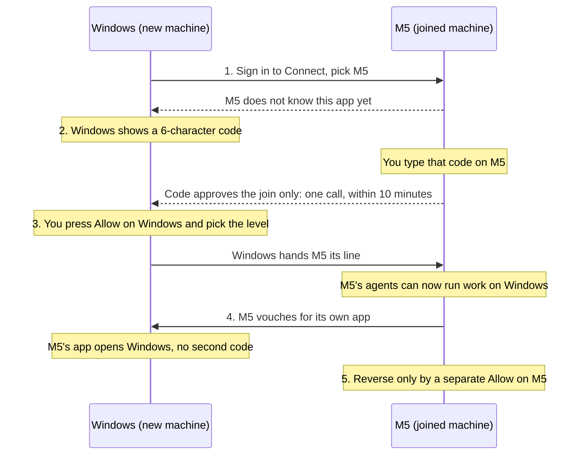

# How joining a machine works

November 19, 2026. Example: a new Windows machine joins M5. "Today" is the released app (1.0.386). "After 1428" is the access design in increment 1428, not built yet; it needs both machines on 1.1.

## The flow after 1428

## What each step gives

| Step | Where | Kind | Today | After 1428 |
|---|---|---|---|---|
| Code typed on M5 | M5 | Device approval | Windows's app becomes a full device on M5 | Join only: one call, 10 minutes, no access to M5 |
| Allow on Windows | Windows | Machine-access grant | M5's agents run work on Windows | Same, and Windows remembers the level you picked |
| Code asked on Windows | Windows | Device approval | Second code for M5's app | Gone: M5 vouches while it has full access to all projects and sign-ins |
| Reverse | M5 | Machine-access grant | Not set up | Offered on M5's joined notice; Windows never opens M5 by itself |

## Do the codes rotate?

- A code lives only while its device keeps asking, for at most 30 minutes from the first ask. After that the device gets a new code.
- A device that stops asking loses its code 5 to 10 minutes after its last ask.
- A server restart always gives a new code, because the code is kept only in memory.
- Deny ends the code at once.
- The code is shown only on the asking device and is typed on the other machine. The 4-character device ID is a hint and never approves anything.
- Once approved, a device never asks that machine again, across restarts and updates, until you press Remove. Approvals are per machine.
- A reset app or a new browser is a new device and asks again.

## Other lifetimes

- M5's worker grant on Windows lasts 30 days and renews by itself.
- M5's management key on Windows lasts one year and does not renew. After 1428 the vouch ends with it, and the code is asked once.
- A Connect sign-in lasts 7 days.

## Status

- Pop-up wording (what Allow opens): PR 712 merged, ships in the next release.
- 1406 (several devices at once, code lifetime): closed.
- 1416 (code shown on the joining machine, Later kept): closed.
- 1422: wording only, true to today: the joined notice and the Allow say what each gives and announce the second code (Anton, November 19, 2026: "Wording now, access later").
- 1428: the access design above (one code, the code only joins, remembered level with a menu to lower it, no automatic open, Remove ends the vouch within a day), between machines on 1.1. It starts from a written baseline and waits for Muse Wonderful after November 23 and your acceptance.
- 1429: retire 1.0, upgrade only, at a quiet moment. Draft with open questions for you.
