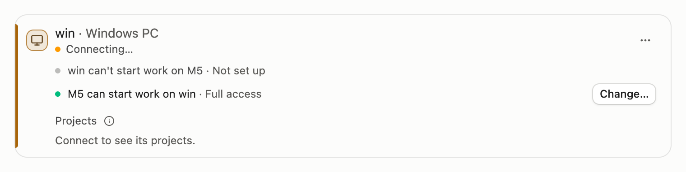

# Saved Windows connection

A Windows machine with a saved Connect relay route, an active M5 work grant and a desktop session still connecting reproduced the extra **Connect** button. The 1.0.398 code matched only direct addresses when deciding whether a route was saved. The revised card matches the relay to the same machine, including when the machine advertises both Connect and Tailscale.

The headless Chrome check rendered the production machine card twice with the same fixture. Switching only the saved-route helper from 1.0.398 to the revised helper removed the header button. Both runs displayed “Connecting…” and “M5 can start work on win · Full access”. The fixture made no connection to a physical Windows machine.

The four focused suites passed all 134 tests. They include the expanded connection details, a saved alternate route, a rejected device and a changed direct address. The final candidate received two independent ship verdicts. GitHub merged it on November 20, 2026 after all 26 checks completed successfully or were skipped as configured. [Pull request 778](https://github.com/anton-abyzov/specwithcode/pull/778)
