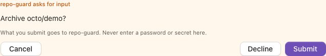

# Live check: an MCP form in a Claude thread

The run passed on November 25, 2026 (05:57 UTC), on M5, headless. It ran against the app built from PR #929 head `6e2061f87`, which includes round 2: only the person answers, answers are checked and redacted, and the raw answers are handed off in process.

## Setup

- A private server (`apps/server/dist/bin.mjs serve` with its own base folder) ran from the verification copy, never the live app or its database.
- Only Claude was enabled, on the installed CLI 2.1.331 with model `claude-haiku-5-5`.
- The project folder held a `.mcp.json` with one stdio test server, `repo-guard`, which has two tools:
  - `delete_repository({repo})` asks for a required string (title "Type <repo> to confirm", description "The full name, owner and repository.") and a boolean "Archive a copy first" that defaults to true.
  - `archive_repository({repo})` asks for a confirmation with no fields.
  - Both set their own request timeout to 30 minutes.
- The thread was created by the user, in Full access.
- Script: `/Users/anton/.specwithcode/m4/scratch/2026-11-25-1481/live/check.mjs`. Test server: `/Users/anton/.specwithcode/m4/scratch/2026-11-25-1481/probe/repo-guard.mjs`. Receipt, server log and screenshots: `/Users/anton/.specwithcode/m4/scratch/2026-11-25-1481/live/run-installed/`.

## Steps and results

| Time (UTC) | Step | Result |
|---|---|---|
| 05:57:33 | Prompt: "Use the repo-guard MCP server's delete_repository tool to delete the repository octo/demo..." | sent |
| 05:57:40 | Card shown (AC-01, AC-07) | Shows "repo-guard asks for input", the message as plain text, the required text field with its description, the checkbox ticked by default, the note "What you submit goes to repo-guard. Never enter a password or secret here.", and Cancel, Decline and Submit |
| 05:57:40 | Full access (AC-03) | The thread runs in Full access, but the card stays open for the person |
| 05:57:40 | Needs you (AC-04) | "Needs you" is on the page while the card is open |
| 05:57:40 | Empty Submit | The card shows "Required." and sends nothing |
| 05:57:40 | "octo/demo" typed, then Submit | One `runtime-request.respond` with `decision: "accept"` and the answers |
| 05:57:44 | Tool result | The thread shows `Deleted octo/demo (test only; archive first: true).`, so the raw answers reached the tool through the hand-off. The card is gone |
| 05:57:44 | Thread records (AC-09) | `orchestration.getThreadProjection` shows the request's answers as `{"confirm":"[redacted]","archive":"[redacted]"}`; the raw value appears nowhere in the projection |
| 05:57:52 | Second prompt: `archive_repository` on octo/demo | A card with no fields (screenshot below) is still open 3 s later on Full access (AC-03, no exemption for confirm-only Claude forms) |
| 05:57:54 | Submit | `answers: {}` is sent, and the thread shows `Archived octo/demo (test only).` |

## Defect found and fixed earlier

The first run, on head `218871a01`, failed. The card was a `<form>` inside the composer's own `<form>`, so Submit also reached the composer's submit handler. The required check never appeared, and the answer did not reach the tool within 3 minutes.

Commit `966da0d14` makes the card a `div role="form"`, with a button Submit and Enter handled inside its fields, and adds a regression test. Evidence of the failed run: `/Users/anton/.specwithcode/m4/scratch/2026-11-25-1481/live/run-installed-1-nested-form/`. The passing run on `966da0d14`, before round 2: `/Users/anton/.specwithcode/m4/scratch/2026-11-25-1481/live/run-installed-2-966da0d/`.

## Proof limits

- Unit and orchestrator tests check these, but the live run does not:
  - the unattended 30-minute timeout (AC-08), Stop, URL mode, the secret refusal, the agent refusal, and two answers at once.
- No test or live step reads the effect outbox row. The code writes the same redacted summary there as in the resolved request, and the adapter receiving the real answer shows the hand-off carried it.
- The HTTP long-call behaviour is in `long-mcp-calls-probe.md`.
- Phones and the coordinator's native controls keep Decline and Cancel only (D-06). The card text is English only (D-07).
