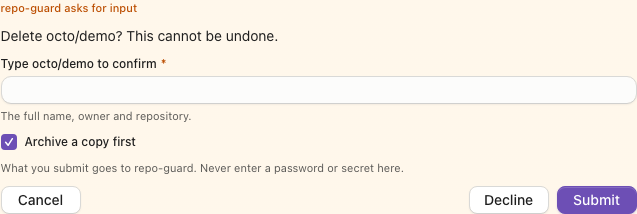

# Live check: an MCP form in a Claude thread

The run passed on November 25, 2026 (04:57 to 04:58 UTC), on M5, headless, against the app built from PR #929 head `966da0d14`.

## Setup

- A private server (`apps/server/dist/bin.mjs serve` with its own base folder) ran from the verification copy, never the live app or its database.
- Only Claude was enabled, on the installed CLI 2.1.331 with model `claude-haiku-5-5`.
- The project folder held a `.mcp.json` with one stdio test server, `repo-guard`. Its `delete_repository({repo})` tool calls `elicitInput` with a required string (title "Type <repo> to confirm", description "The full name, owner and repository.") and a boolean "Archive a copy first" that defaults to true. The test server's own request timeout is 30 minutes.
- The thread was created by the user, in Full access.
- Script: `/Users/anton/.specwithcode/m4/scratch/2026-11-25-1481/live/check.mjs`. Receipt, server log and screenshots: `/Users/anton/.specwithcode/m4/scratch/2026-11-25-1481/live/run-installed/`.

## Steps and results

| Time (UTC) | Step | Result |
|---|---|---|
| 04:57:51 | Prompt: "Use the repo-guard MCP server's delete_repository tool to delete the repository octo/demo..." | sent |
| 04:58:00 | Card shown (AC-01, AC-07) | "repo-guard asks for input", the message, the required text field with its description, the checkbox ticked by default, the note "What you submit goes to repo-guard. Never enter a password or secret here.", and Cancel, Decline and Submit |
| 04:58:00 | Full access (AC-03) | The thread runs in Full access, yet the card stayed open for the person because a form with fields offers no automatic accept |
| 04:58:00 | Needs you (AC-04) | "Needs you" is on the page while the card is open |
| 04:58:00 | Empty Submit | The card shows "Required." and sends nothing |
| 04:58:00 | "octo/demo" typed, then Submit | One `runtime-request.respond` with `decision: "accept"` and `answers: {"confirm":"octo/demo"}` (the default archive value is included) |
| 04:58:03 | Tool result | The thread shows `Deleted octo/demo (test only; archive first: true).` and the card is gone |

## Defect found and fixed

The first run, on head `218871a01`, failed. The card was a `<form>` inside the composer's own `<form>`, so Submit also reached the composer's submit handler. The required check never appeared, and the answer did not reach the tool within 3 minutes.

Commit `966da0d14` makes the card a `div role="form"`, with a button Submit and Enter handled inside its fields. It adds a regression test, "never submits the composer form it sits in".

The failed run's evidence is in `/Users/anton/.specwithcode/m4/scratch/2026-11-25-1481/live/run-installed-1-nested-form/`.

## Proof limits

- Only the stdio test server was used here. The HTTP long-call behaviour is in `long-mcp-calls-probe.md`.
- The unattended 30-minute timeout (AC-08), Stop, and URL mode were checked by unit tests, not live.
- Phones and the coordinator's native controls keep Decline and Cancel only (D-06). The card text is English only (D-07).
