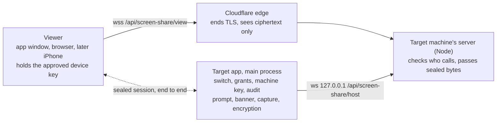

# Plan: remote desktop in SpecWithCode

Goal: from any of the owner's approved devices, see and then control the whole screen of another of their machines, with the session encrypted end to end and no path for an agent.

`spec.md` holds the acceptance criteria and tasks for slice 1. This file holds the design for every slice.

## 1. Who does what

- **Viewer.** Holds the device proof key that 1327 approved on the target with a typed code (web: non-extractable P-256 in IndexedDB, `apps/web/src/cloud/dpop.ts`; iPhone: Secure Enclave, `Dpop.swift:212`). It signs each session and pins the target's screen-sharing key.
- **Server on the target.** Decides only two things, from the full session and never from scopes alone: is the viewer a person's approved device, and is the host this machine's own app. Then it passes bytes it cannot read.
- **Target app, main process.** The only place that decides to share, and the only place that sees the screen. It already owns the macOS Screen Recording grant (`reference_fleet_phone_permissions.md`, "computer use permission persists").

Why the main process and not the server or a window: the server runs as plain Node with no screen grant and is reachable by every session class; a window's renderer loads web code and disappears when the last window closes (today's computer-use host has both problems).

## 2. Access rules

| Caller | View | Host | Switch, grants | Answer the prompt |
|---|---|---|---|---|
| Approved Connect device (`cloud-connect`, `jkt:` key on the list) | yes, after approval | no | no | no |
| Phone link with an approved key | yes, after approval (slice 5 client) | no | no | no |
| The target's own app (`desktop-bootstrap`, loopback, proof on every connection) | no | yes | through its windows, with system authentication | the prompt window, with system authentication |
| Phone link with no key (`link:`) | no | no | no | no |
| Pairing code, LAN or SSH window (`one-time-token`) | no | no | no | no |
| Local CLI (`local-cli-owner`), startup link, dev tokens | no | no | no | no |
| Management key (`fleet-invitation`, coordinator) | no | no | no | no |
| Worker grant, outside MCP client (`mcp-client`) | no | no | no | no |
| Agent thread (MCP tools, computer use) | no tool exists | no | no | a click is not enough: Allow needs Touch ID or the password |
| A process that only rewrites this user's files on the target | already has the screen through the app's grants | can stand in for the host, without the machine key (a viewer that saved the key refuses it) | no | named limit (`spec.md`, Threat model, AC-04) |
| A process that runs code as the app on the target | already has the screen | yes, with the machine key | yes | not defended (`spec.md`, Threat model, D-15) |

- The viewer rule lives in `apps/server/src/auth/personDevice.ts`, shared with 1488 (its AC-07).
- A device removed from the list loses its socket within 5 seconds, a revoked sign-in at once in the same process and within 30 seconds from another (`serveSocketUntilSessionEnds`, `apps/server/src/auth/http.ts:325`). Expiry is not watched for these sessions today, so the screen-sharing socket sets its own timer to the session's expiry. A sign-in with no expiry is refused.
- The host's proof is the desktop owner proof (installed service) or a host proof made from the launch secret under its own label (a backend the app started). The app's window holds the bootstrap token from that secret; the token does not pass as the host proof. The app sends its proof again every 4 minutes and the server checks the latest when a viewer opens.
- The relay keeps bounds that do not depend on the app: handshake 20 s, first sealed word 5 s after the proof, longest session life, 12 opens per device in 10 minutes, 64 KB for anything a viewer sends, no text from a viewer.
- The switch and grants never pass through the server, so `settings:write`, `access:write` and `server.updateSettings` cannot reach them.

## 3. The sealed session

On the wire every binary message is one type byte (`SCREEN_SHARE_WIRE`: hello 1, challenge 2, proof 3, sealed 4, knock 5) and a body: UTF-8 JSON for hello, challenge and proof, one sealed record for sealed, one compact JWS for the knock. The knock comes first and stops at the server: it answers the server's `{ t: "prove", nonce, environmentId }` with the device key's signature over the nonce and the machine id (type `swc-screen-share-knock+jws`, checked against the key the sign-in is bound to), and only then is a session opened, counted and told to the app. Inside the seal a record starts with its own type byte (`SCREEN_SHARE_RECORD`, from 16 up: viewer to machine 16 to 19, machine to viewer 32 and 33); the two number spaces share no value. `encodeScreenShareWire`, `encodeScreenShareWireJson`, `decodeScreenShareWire` and `decodeScreenShareJson` in `packages/contracts/src/screenShare.ts` are the only encoders. On the host socket each binary message is prefixed with the 36-character session id. Each side's handshake start is single-use: it answers one challenge or one proof and is discarded on success, failure, timeout or retry.

All of it is in `packages/shared/src/screenShareChannel.ts` (`@noble` for X25519 and Ed25519, WebCrypto for AES-GCM; runs in the browser, in Electron's main process and in tests under Node 22).

1. **Viewer hello:** mode (`view`), a fresh X25519 public key `vk`, the device public key as a JWK, whether it already holds a saved key for this machine, and `c = SHA-256(r)` for a fresh 32-byte random `r` it keeps to itself.
2. **Target challenge:** a 32-byte nonce, a fresh X25519 public key `mk`, the machine's Ed25519 screen-sharing key `mid`, and `mid`'s signature over the transcript hash `th = SHA-256("specwithcode screen share v1" | environment id | session id | mode | vk | device key thumbprint | c | nonce | mk | mid)`.
3. **Viewer proof:** the viewer checks the signature and its saved key, then sends an ES256 JWS made with the device key: header `{typ: "swc-screen-share+jws", alg, jwk}`, payload `{aud: environment id, sid, mode, th, iat, r}`. The target checks `SHA-256(r) = c`.
4. **Target checks:** the JWK's thumbprint equals the device key the server attested for this socket; the signature holds; `th` equals its own; `iat` is within 60 seconds; the nonce is unused. Then section 4 decides.
5. **Keys:** `HKDF-SHA256(X25519(mk, vk), salt = nonce, info = "specwithcode screen share v1 keys" | th)` gives one AES-256-GCM key per direction. Each record is `type (1) | counter (8) | ciphertext | tag`, the nonce is the counter, the session id, type and counter are authenticated. A counter that is not exactly the next one ends the session.

What each part buys:

- **The device signature protects the screen.** The target only ever encrypts to a `vk` that an approved device key signed together with the target's own `mk` and nonce. Someone on the path who swaps a key, or who holds a replayed WebSocket ticket, cannot produce that signature, so they can neither start a session nor read one.
- **The machine key protects the viewer.** Without it, someone on the path could answer as the target and show a made-up screen, which matters once the owner types (slice 2). The viewer saves `mid` per machine on first use. Trust on first use is one enforced step, not a display. Both ends derive a 6-digit code from the session secret, `th` and `r`. Only the target's prompt shows it. The viewer shows a field, compares what is typed with its own code, and only then saves `mid` and sends the code back inside the sealed session; the target sends no frame before that. Someone answering as the target from the network cannot put a code on the real machine's screen, and because the target fixed `mk` and its nonce before `r` was revealed, it cannot search for a session whose code equals one shown elsewhere. What a first use is, the target decides: its store records each device whose person typed its code, and a device without that record always gets the prompt, even where a grant exists and whatever the viewer says about its saved key. So the first view needs a person at the machine. The code protects the person at the viewer against a stand-in; the target's own protection is the device signature, the prompt and system authentication.
- **Separate from DPoP.** Same key, different `typ` and payload, so neither verifier accepts the other's token.
- 1488's `signInSeal.ts` covers one-way sealing to a view key. The two modules stay separate; they share the `@noble` primitives and the device-key signing helper `signWithDeviceKey(typ, payload)` in `apps/web/src/cloud/dpop.ts`.

## 4. Approval, the banner and the store

**Store** (`apps/desktop/src/screenShare/ScreenShareStore.ts`, `screenShareSeal.ts`): one file in the app's data folder. A random 256-bit store key is wrapped by `safeStorage` (a Keychain key bound to the app's signature; on macOS it is AES-CBC with no integrity check, hence the second layer). The contents are AES-256-GCM under the store key with the purpose and version authenticated. It holds the switch, the grants (device thumbprint, name, granted, last used), the machine key, the cooldown counts and the last 500 audit entries. A file that does not open reads as off with no grants, and a new machine key is made, so every viewer is asked again and Settings says the store was reset. Where `safeStorage` is unavailable nothing is stored and the switch cannot be turned on. The audit list can be erased by a same-user process: it is evidence about remote devices only.

**System authentication:** `systemPreferences.promptTouchID(reason)` in the main process. Electron 44 evaluates user presence (`kSecAccessControlUserPresence`): Touch ID, Apple Watch or the account password, in the system's own dialog. A rejected promise, for any reason, means no. Used for turning on, Allow once and Always allow.

**Turning it on:** Settings > Machines > Screen sharing, on that machine's own app. The window asks the main process, which runs system authentication. A window showing another machine has no bridge to that machine's main process, so it can only read the state.

**Prompt** (`ScreenShareWindows.ts`, the `MacPermissionHelper` pattern: frameless, always on top, own preload, answers accepted only from its own frame): "Work laptop (ID 7F3A) wants to view this Mac's screen." The name is the one on the approved list. First use adds: "Type this code on that device: 482 913." Deny, Allow once, Always allow this device; each Allow runs system authentication. 60 seconds, then Deny. Three counted ends for a device in 10 minutes silence it for 10 minutes: Deny, a prompt nobody answered, a wrong code, or the viewer leaving or sending something invalid while a person was being asked. Nothing before the device's proof counts (`spec.md`, AC-08).

**Banner:** always on top, on every desktop and over full-screen apps: "Anton's MacBook Pro is viewing this screen · 02:13 · Stop". It is created before the first frame. No banner, no session. macOS adds its own screen-recording mark in the menu bar.

**Audit:** every attempt and session, in the store, listed in Settings on that machine.

**Timeouts:** section D-10 in `spec.md`.

**What each end reads, and when.** The relay passes sealed records as soon as a proof went by, valid or not, so these duties are the ends' own:

| Stage | Target (app) | Viewer |
|---|---|---|
| Before hello | reads only a hello; anything else ends the session | sends hello after the server's `open`, having checked the machine id in it |
| After hello | sends one challenge, reads only a proof | reads only a challenge; checks the signature and the saved key; sends the proof |
| Proof accepted | may now open sealed records; shows the prompt or goes live by grant | may now open sealed records; draws nothing |
| Asking, code | reads only "end" and, in the code stage, the code; sends states, no frame | shows the state words and the code field; draws nothing |
| Live | sends frames; reads "frame received", "show display", "end" | draws frames only now, and only if its own code check passed or the key was already saved |
| Any stage | an unexpected or unreadable record ends the session | a record that is not a state or a frame ends the session |

The app sends its status as soon as the server says `attached`; until then the server answers viewers "not available right now". Status may change at any time; turning off ends the session. A replaced app's late messages are dropped by the server.

## 5. Capture and input per operating system

| | macOS | Windows | Linux |
|---|---|---|---|
| Stills (slices 1, 2) | Electron `desktopCapturer` in the main process (ScreenCaptureKit underneath); fallback `/usr/sbin/screencapture` | `desktopCapturer` (DXGI duplication or Windows Graphics Capture underneath) | one xdg-desktop-portal ScreenCast session per screen-sharing session, frames read from PipeWire; the portal's picker is a consent dialog, so repeated still calls are not used. X11 directly |
| Video (slice 3) | a hidden capture window in its own session, `getDisplayMedia` answered only when the main process armed it | same | same; the portal draws its own picker unless a restore token is kept |
| Permission | Screen Recording for the app; granted once, kept across updates; a fresh grant needs a relaunch | none | the portal's own consent, per session or remembered |
| Input (slice 2 and later) | a small signed Swift helper posting `CGEvent`s (pointer, keys, scroll); see the rules below | `SendInput` through `ffi-rs` (already used for `user32`); Windows drops it for elevated windows, so the viewer says "this window needs an administrator at the machine" | the portal's RemoteDesktop session (libei) from a Rust helper using `ashpd`; XTest on X11 |
| Lock screen | placard; `powerMonitor` lock events plus `getSystemIdleState` before and after each capture; synthetic input at the login window is not attempted | placard; the secure desktop needs a system service, not planned | placard |
| Elevation prompts | macOS ignores synthetic clicks on its consent sheets; typed text is refused while a system prompt has focus (D-04) | UAC's secure desktop is not captured; placard | polkit prompts as any window; typed text refused (D-04) |

- macOS capture numbers from this machine are in `reports/capture-spike.md`.
- The existing computer-use input path is not reused: it yields to the local person, aborts when the pointer moves and takes a process per action.
- **Rules for the macOS input helper (slice 2), with a spike first.** Whether a separately signed helper inside the bundle is charged to the app's Accessibility grant is unproven; slice 2 starts by measuring it. The helper runs only during a live control session and exits with it. It takes commands only over a pipe it inherits from the app, never a listening socket or a named service. It learns of the banner's Stop only over that same pipe, so its real stop of its own is silence: it exits when the pipe closes or says nothing for 2 minutes.
- **Display sleep.** A session keeps the display from sleeping (`powerSaveBlocker`, `prevent-display-sleep`). It does not wake a sleeping display: that would light a screen in a room nobody chose to show. The viewer says the display may be asleep.

## 6. Transport

- **Slices 1 and 2: sealed frames over the existing connection.** JPEG at 1920 px, only on change, one unconfirmed frame at a time, so a slow link gets fewer frames and never a backlog. Works on every route Connect works on and needs no new network service. About 0.2 to 0.6 MB per second while the screen moves, nothing while it is still.
- **Slice 3: WebRTC video.** The offer, answer and candidates travel inside the sealed session, so the DTLS fingerprints are authenticated end to end and the media stays private even through a relay. STUN from `stun.cloudflare.com`. If no path forms in 8 seconds the session stays on frames.
- **Slice 4: TURN.** A relay route `POST /v1/environments/:id/turn-credentials`, called by the target with its environment credential, returns Cloudflare Realtime TURN credentials valid for 10 minutes, one live credential per machine, renewed inside the sealed session; the target hands them to the viewer inside the session. Cloudflare lists 1,000 GB a month free, then $0.05 per GB; a relayed 1080p hour is roughly 1 to 2 GB. The relay stops issuing when its own estimate (minutes issued times a worst-case bitrate) nears 800 GB. That is an estimate: a credential is usable for any traffic until it expires and Cloudflare meters after the fact, so the relay cannot promise no bill. Before slice 4 the owner confirms on the Cloudflare plan that overage blocks (D-03). Unset key: the route answers 503 and sessions stay direct or on frames.

## 7. Control (slice 2 and after)

- **A separate permission.** "Allow control" is its own prompt and its own grant; a view grant never implies it. The banner reads "is controlling" and Stop works the same.
- **Computer use pauses on the target** while a person controls it, so an agent and the owner never fight for the pointer, and resumes when the session ends.
- **Secure input and passwords.** While macOS reports secure event input, or a system prompt (SecurityAgent, loginwindow) has focus, typed text is not forwarded and the viewer says why. No click is sent either while SecurityAgent or loginwindow has focus: a click can confirm a system sheet. How to detect that focus is not settled (no API is named here on purpose); it is part of the slice 2 spike, and if it cannot be detected reliably the rule becomes "no clicks while secure input is on" plus a stated limit. This keeps 1438 D-01 (an administrator password is typed only in the system's own prompt at the machine). A password field on a web page does not turn secure input on, so the app cannot tell it from any text field; what to do about that is the open half of D-04.
- **Keys:** physical key codes plus layout-independent text, modifier state reset on every end so no key stays held.
- **Clipboard and files:** off by default. Clipboard is a per-session opt-in for text only. Files stay on `studio_file_transfer`.

## 8. Touch ID, passkeys and approving from the phone

Touch ID cannot be relayed. The fingerprint check happens in the Mac's Secure Enclave and needs a finger on that Mac's sensor; no software event stands in for it, by design.

What works instead:

| Where the owner is | What works |
|---|---|
| Near the target Mac, phone in hand | Chrome's "Use a phone or tablet" passkey QR, shown on the remote screen. The phone approves with Face ID. The phone and that Mac must be within Bluetooth range: the QR flow checks it. |
| Away from the target Mac | Approvals that happen on the phone over the internet: a Google or Microsoft prompt, Duo, an authenticator code, an emailed or texted code typed into the page. Password plus one of these goes through the 1488 sign-in view, where typed text is sealed. |
| Away, and the site offers only a passkey held on that Mac or by QR | Not possible remotely. Sign in once at the machine, or add a second method to that account. |

So "from anywhere" holds for phone prompts and codes, and does not hold for the passkey QR.

## 9. Slices

| Slice | Delivers | Own increment | Needs from the owner |
|---|---|---|---|
| 1 | macOS target, view-only, sealed frames, app and browser viewer | this one, 1490 | nothing; D-01 and D-02 can change its defaults |
| 2 | macOS control: pointer, keys, scroll; separate approval; computer use paused | next | nothing more: D-04 is answered (no typing into browsers) |
| 3 | WebRTC video with frames as the fallback | later | nothing |
| 4 | TURN on the relay with a monthly cap | later | D-03 (spend) |
| 5 | iPhone viewer, native (CryptoKit, no new package), frames first | later | nothing |
| 6 | Windows target: view, then control | later | nothing |
| 7 | Linux target: view, then control through the portal | later | nothing |
| 8 | Clipboard text, opt-in per session | later | a decision when it comes |

Each slice is one pull request or a short stack, reviewed on Meta Muse at high effort, merged when green, then a release request.

## 10. Rejected

- **macOS Screen Sharing or VNC behind Connect.** A second sign-in with the Mac's account password over the relay, no device approval, no banner of ours, and an agent with a shell could open it.
- **Reusing the computer-use host and broker.** Any `terminal:operate` session can register as host, the host lives in a window, and its input yields to the local person.
- **The access card for approval.** A remote window or a management key can answer it, so a viewer could approve itself.
- **A switch in `settings.json`.** Anything with `settings:write`, or a file edit, flips it.
- **Encrypting in the server.** One more process that sees the screen, reachable by every session class.
- **WebRTC first.** See D-05.
- **Trusting the relay for the machine key.** It would make the relay able to stand in for a machine; pinning after one typed code avoids that.
- **A click-only prompt.** A click can be synthetic; see D-13.
- **Closing Electron's run-as-node and inspect switches here.** Right, and not in this increment: the app starts its backend and helpers through run-as-node, so it needs its own change and release.
- **A hash-chained audit list.** A same-user process can delete the whole file; the list is evidence about remote devices only, and says so.

## 11. Proof limits for slice 1

- Capture on a Developer ID build with a real Screen Recording grant, the banner over a full-screen app, and a session across Connect between two Macs can only be shown on installed releases with the owner turning the switch on. Until then: unit tests on the channel, the guards, the session rules and the store, and a headless viewer fixture fed by a fake target.
- System authentication on a Mac with no Touch ID sensor in reach is unverified (`spec.md`, Open).
