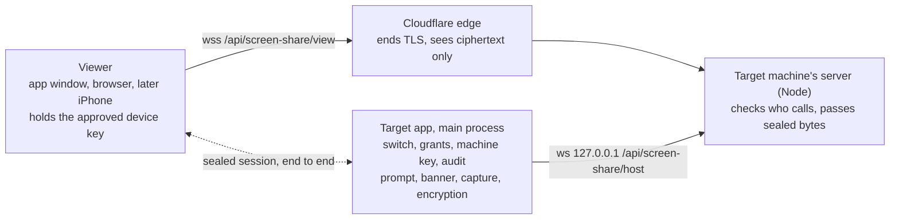

# Plan: remote desktop in SpecWithCode

Goal: from any of the owner's approved devices, see and then control the whole screen of another of their machines, with the session encrypted end to end and no path for an agent.

`spec.md` holds the acceptance criteria and tasks for slice 1. This file holds the design for every slice.

## 1. Who does what

- **Viewer.** Holds the device proof key that 1327 approved on the target with a typed code (web: non-extractable P-256 in IndexedDB, `apps/web/src/cloud/dpop.ts`; iPhone: Secure Enclave, `Dpop.swift:212`). It signs each session and pins the target's screen-sharing key.
- **Server on the target.** Decides only two things, from the full session and never from scopes alone: is the viewer a person's approved device, and is the host this machine's own app. Then it passes bytes it cannot read.
- **Target app, main process.** The only place that decides to share, and the only place that sees the screen. It already owns the macOS Screen Recording grant (`reference_fleet_phone_permissions.md`, "computer use permission persists").

Why the main process and not the server or a window: the server runs as plain Node with no screen grant and is reachable by every session class; a window's renderer loads web code and disappears when the last window closes (today's computer-use host has both problems).

## 2. Access rules

| Caller | View | Host | Switch, grants | Answer the prompt |
|---|---|---|---|---|
| Approved Connect device (`cloud-connect`, `jkt:` key on the list) | yes, after approval | no | no | no |
| Phone link with an approved key | yes, after approval (slice 5 client) | no | no | no |
| The target's own app (`desktop-bootstrap`, loopback) | no | yes | through its windows, with a native confirmation | the prompt window itself |
| Phone link with no key (`link:`) | no | no | no | no |
| Pairing code, LAN or SSH window (`one-time-token`) | no | no | no | no |
| Local CLI (`local-cli-owner`), startup link, dev tokens | no | no | no | no |
| Management key (`fleet-invitation`, coordinator) | no | no | no | no |
| Worker grant, outside MCP client (`mcp-client`) | no | no | no | no |
| Agent thread (MCP tools, shell) | no tool exists | no | no | computer use refuses the app's own windows |

- The viewer rule lives in `apps/server/src/auth/personDevice.ts`, shared with 1488 (its AC-07).
- A device removed from the list, or whose sign-in ends, loses its socket within 5 seconds (`serveSocketUntilSessionEnds`, `apps/server/src/auth/http.ts:325`).
- The switch and grants never pass through the server, so `settings:write`, `access:write` and `server.updateSettings` cannot reach them.

## 3. The sealed session

All of it is in `packages/shared/src/screenShareChannel.ts` (WebCrypto, runs in the browser, in Electron's main process and in tests under Node 22).

1. **Viewer hello:** mode (`view`), a fresh X25519 public key `vk`, the device public key as a JWK, and whether it already holds a saved key for this machine.
2. **Target challenge:** a 32-byte nonce, a fresh X25519 public key `mk`, the machine's Ed25519 screen-sharing key `mid`, and `mid`'s signature over the transcript hash `th = SHA-256("specwithcode screen share v1" | environment id | session id | mode | vk | device key thumbprint | nonce | mk | mid)`.
3. **Viewer proof:** the viewer checks the signature and its saved key, then sends an ES256 JWS made with the device key: header `{typ: "swc-screen-share+jws", alg, jwk}`, payload `{aud: environment id, sid, mode, th, iat}`.
4. **Target checks:** the JWK's thumbprint equals the device key the server attested for this socket; the signature holds; `th` equals its own; `iat` is within 60 seconds; the nonce is unused. Then section 4 decides.
5. **Keys:** `HKDF-SHA256(X25519(mk, vk), salt = nonce, info = "specwithcode screen share v1 keys" | th)` gives one AES-256-GCM key per direction. Each record is `type (1) | counter (8) | ciphertext | tag`, the nonce is the counter, the session id, type and counter are authenticated. A counter that is not exactly the next one ends the session.

What each part buys:

- **The device signature protects the screen.** The target only ever encrypts to a `vk` that an approved device key signed together with the target's own `mk` and nonce. Someone on the path who swaps a key, or who holds a replayed WebSocket ticket, cannot produce that signature, so they can neither start a session nor read one.
- **The machine key protects the viewer.** Without it, someone on the path could answer as the target and show a made-up screen, which matters once the owner types (slice 2). The viewer saves `mid` per machine on first use. Trust on first use rests on one comparison: the prompt on the target and the viewer both show a short code made from `mid` and the device key (four groups of four hex digits, 1488's fingerprint format). A viewer with no saved key always gets the prompt, even where a grant exists.
- **Separate from DPoP.** Same key, different `typ` and payload, so neither verifier accepts the other's token.
- 1488's `signInSeal.ts` covers one-way sealing to a view key. Its X25519 and HKDF helpers are reused once it is on `main`; this channel adds the two signatures and the counters.

## 4. Approval, the banner and the store

**Store** (`apps/desktop/src/screenShare/ScreenShareStore.ts`): one file in the app's data folder, encrypted with `safeStorage` (a Keychain key bound to the app's signature). It holds the switch, the grants (device thumbprint, name, granted, last used), the machine key and the last 500 audit entries. A file that does not decrypt, or that names another machine, reads as off with no grants, and a new machine key is made, so every viewer is asked again.

**Turning it on:** Settings > Machines > Screen sharing, on that machine's own app. The window asks the main process, which shows a native confirmation. A window showing another machine has no bridge to that machine's main process, so it can only read the state.

**Prompt** (`ScreenShareWindows.ts`, the `MacPermissionHelper` pattern: frameless, always on top, own preload, answers accepted only from its own frame): "Anton's MacBook Pro (ID 7F3A) wants to view this Mac's screen. Code 41c2-9a0e-77b1-03fd." Deny, Allow once, Always allow this device. 60 seconds, then Deny. Three refusals or timeouts for a device in 10 minutes silence it for 10 minutes.

**Banner:** always on top, on every desktop and over full-screen apps: "Anton's MacBook Pro is viewing this screen · 02:13 · Stop". It is created before the first frame. No banner, no session. macOS adds its own screen-recording mark in the menu bar.

**Audit:** every attempt and session, in the store, listed in Settings on that machine.

**Timeouts:** section D-10 in `spec.md`.

## 5. Capture and input per operating system

| | macOS | Windows | Linux |
|---|---|---|---|
| Stills (slices 1, 2) | Electron `desktopCapturer` in the main process (ScreenCaptureKit underneath); fallback `/usr/sbin/screencapture` | `desktopCapturer` (DXGI duplication or Windows Graphics Capture underneath) | `desktopCapturer` through the xdg-desktop-portal ScreenCast and PipeWire on Wayland; X11 directly |
| Video (slice 3) | a hidden capture window in its own session, `getDisplayMedia` answered only when the main process armed it | same | same; the portal draws its own picker unless a restore token is kept |
| Permission | Screen Recording for the app; granted once, kept across updates; a fresh grant needs a relaunch | none | the portal's own consent, per session or remembered |
| Input (slice 2 and later) | a small signed Swift helper posting `CGEvent`s (pointer, keys, scroll), started by the app so the app's Accessibility grant applies | `SendInput` through `ffi-rs` (already used for `user32`) | the portal's RemoteDesktop session (libei) from a Rust helper using `ashpd`; XTest on X11 |
| Lock screen | placard; synthetic input at the login window is unreliable and is not attempted | placard; the secure desktop needs a system service, not planned | placard |
| Elevation prompts | macOS ignores synthetic clicks on its consent sheets; typed text is refused while a system prompt has focus (D-04) | UAC's secure desktop is not captured; placard | polkit prompts as any window; typed text refused (D-04) |

- macOS capture numbers from this machine are in `reports/capture-spike.md`.
- The existing computer-use input path is not reused: it yields to the local person, aborts when the pointer moves and takes a process per action.

## 6. Transport

- **Slices 1 and 2: sealed frames over the existing connection.** JPEG at 1920 px, only on change, one unconfirmed frame at a time, so a slow link gets fewer frames and never a backlog. Works on every route Connect works on and needs no new network service. About 0.2 to 0.6 MB per second while the screen moves, nothing while it is still.
- **Slice 3: WebRTC video.** The offer, answer and candidates travel inside the sealed session, so the DTLS fingerprints are authenticated end to end and the media stays private even through a relay. STUN from `stun.cloudflare.com`. If no path forms in 8 seconds the session stays on frames.
- **Slice 4: TURN.** A relay route `POST /v1/environments/:id/turn-credentials`, called by the target with its environment credential, returns Cloudflare Realtime TURN credentials valid for one hour; the target hands them to the viewer inside the session. Cloudflare lists 1,000 GB a month free, then $0.05 per GB; a relayed 1080p hour is roughly 1 to 2 GB. A per-account monthly cap in the relay keeps it inside what the owner allows (D-03). Unset key: the route answers 503 and sessions stay direct or on frames.

## 7. Control (slice 2 and after)

- **A separate permission.** "Allow control" is its own prompt and its own grant; a view grant never implies it. The banner reads "is controlling" and Stop works the same.
- **Computer use pauses on the target** while a person controls it, so an agent and the owner never fight for the pointer, and resumes when the session ends.
- **Secure input and passwords.** While macOS reports secure event input, or a system prompt (SecurityAgent, loginwindow) has focus, typed text is not forwarded and the viewer says why. Clicks still work. This keeps 1438 D-01 (an administrator password is typed only in the system's own prompt at the machine). Whether website and app password fields may be typed is D-04, for the owner. The viewer cannot see whether a field is a password field except through this signal.
- **Keys:** physical key codes plus layout-independent text, modifier state reset on every end so no key stays held.
- **Clipboard and files:** off by default. Clipboard is a per-session opt-in for text only. Files stay on `studio_file_transfer`.

## 8. Touch ID, passkeys and approving from the phone

Touch ID cannot be relayed. The fingerprint check happens in the Mac's Secure Enclave and needs a finger on that Mac's sensor; no software event stands in for it, by design.

What works instead:

| Where the owner is | What works |
|---|---|
| Near the target Mac, phone in hand | Chrome's "Use a phone or tablet" passkey QR, shown on the remote screen. The phone approves with Face ID. The phone and that Mac must be within Bluetooth range: the QR flow checks it. |
| Away from the target Mac | Approvals that happen on the phone over the internet: a Google or Microsoft prompt, Duo, an authenticator code, an emailed or texted code typed into the page. Password plus one of these goes through the 1488 sign-in view, where typed text is sealed. |
| Away, and the site offers only a passkey held on that Mac or by QR | Not possible remotely. Sign in once at the machine, or add a second method to that account. |

So "from anywhere" holds for phone prompts and codes, and does not hold for the passkey QR.

## 9. Slices

| Slice | Delivers | Own increment | Needs from the owner |
|---|---|---|---|
| 1 | macOS target, view-only, sealed frames, app and browser viewer | this one, 1490 | nothing; D-01 and D-02 can change its defaults |
| 2 | macOS control: pointer, keys, scroll; separate approval; computer use paused | next | D-04 |
| 3 | WebRTC video with frames as the fallback | later | nothing |
| 4 | TURN on the relay with a monthly cap | later | D-03 (spend) |
| 5 | iPhone viewer, native (CryptoKit, no new package), frames first | later | nothing |
| 6 | Windows target: view, then control | later | nothing |
| 7 | Linux target: view, then control through the portal | later | nothing |
| 8 | Clipboard text, opt-in per session | later | a decision when it comes |

Each slice is one pull request or a short stack, reviewed on Meta Muse at high effort, merged when green, then a release request.

## 10. Rejected

- **macOS Screen Sharing or VNC behind Connect.** A second sign-in with the Mac's account password over the relay, no device approval, no banner of ours, and an agent with a shell could open it.
- **Reusing the computer-use host and broker.** Any `terminal:operate` session can register as host, the host lives in a window, and its input yields to the local person.
- **The access card for approval.** A remote window or a management key can answer it, so a viewer could approve itself.
- **A switch in `settings.json`.** Anything with `settings:write`, or a file edit, flips it.
- **Encrypting in the server.** One more process that sees the screen, reachable by every session class.
- **WebRTC first.** See D-05.
- **Trusting the relay for the machine key.** It would make the relay able to stand in for a machine; pinning with one code comparison avoids that.

## 11. Proof limits for slice 1

- Capture on a Developer ID build with a real Screen Recording grant, the banner over a full-screen app, and a session across Connect between two Macs can only be shown on installed releases with the owner turning the switch on. Until then: unit tests on the channel, the guards, the session rules and the store, and a headless viewer fixture fed by a fake target.
