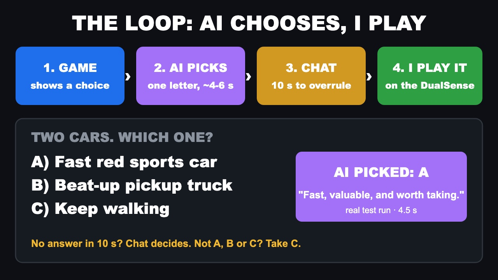

# AI picks, I play: GTA 6 live decision test

November 19, 2026. Tested live before the stream. Every answer below came from a real model call; nothing was mocked, and nothing was sent to the game.



## The example, as it runs on stream

# Two cars. Which one?

## A) Fast red sports car
## B) Beat-up pickup truck
## C) Keep walking

# AI picked: A

## "Fast, valuable, and worth taking." (4.49 seconds)

## What the test showed

- **The AI answered every time.** 15 of 15 calls returned a valid letter (A, B or C) with a short reason.
- **It is not instant.** None of the 15 came back in under 3 seconds. The fastest took 3.75 seconds and the slowest 8.31 seconds. The quickest model, gpt-5.6-luna, typically took about 4.5 seconds.
- **The 10-second rule holds.** Every answer landed inside the 10-second window, so chat never had to take over in testing.
- **The AI never touches the controller.** It picks a letter; I press the buttons on a DualSense. That is the whole loop tonight.

## Results by model

Measured end to end, from sending the prompt to getting the full reply, on the streaming Mac. Each model got the same 5 situations.

| Model (through GitHub Copilot) | Answers | Typical time | Fastest | Slowest | Under 3 s |
|---|---|---|---|---|---|
| gpt-5.6-luna | 5 of 5 | 4.49 s | 4.12 s | 4.79 s | 0 of 5 |
| mai-code-2-flash | 5 of 5 | 5.25 s | 3.75 s | 8.31 s | 0 of 5 |
| claude-haiku-4.5 | 5 of 5 | 6.11 s | 4.68 s | 6.91 s | 0 of 5 |

## Every answer

| # | Model | Pick | Time | Under 3 s | Exact reply |
|---|---|---|---|---|---|
| 1 | gpt-5.6-luna | C | 4.23 s | no | C — Safer to observe before acting. |
| 1 | claude-haiku-4.5 | B | 6.15 s | no | B – Lucia needs supplies for the mission ahead. |
| 1 | mai-code-2-flash | C | 5.05 s | no | C — Watching avoids unnecessary risk. |
| 2 | gpt-5.6-luna | C | 4.55 s | no | C — Pull over safely before answering. |
| 2 | claude-haiku-4.5 | C | 5.47 s | no | C  Prevents crashes. Safer to focus on unknown caller. |
| 2 | mai-code-2-flash | C | 8.31 s | no | C; pull over safely before answering. |
| 3 | gpt-5.6-luna | A | 4.49 s | no | A — Fast, valuable, and worth taking. |
| 3 | claude-haiku-4.5 | A | 4.68 s | no | A – Sports cars faster, better for escapes, more fun gameplay. |
| 3 | mai-code-2-flash | C | 3.75 s | no | C — keep walking; unknown cars and GTA chaos. |
| 4 | gpt-5.6-luna | A | 4.79 s | no | A — Helping may earn goodwill or a reward. |
| 4 | claude-haiku-4.5 | C | 6.91 s | no | C  Police handle lost dog reports, not random civilians. |
| 4 | mai-code-2-flash | A | 5.25 s | no | A) Helping is the compassionate choice. |
| 5 | gpt-5.6-luna | C | 4.12 s | no | C — Beach road seems safest. |
| 5 | claude-haiku-4.5 | C | 6.11 s | no | C  Scenic cover with good escape routes nearby. |
| 5 | mai-code-2-flash | C | 5.32 s | no | C |

The five situations:

1. Lucia is parked outside a gas station at night. A clerk is closing up. A) Drive past and keep moving. B) Go in and buy snacks. C) Wait in the car and watch.
2. Jason gets a phone call from an unknown number while driving on the highway. A) Answer the call. B) Ignore it. C) Pull over first, then answer.
3. Two cars in front of you: a fast red sports car and a beat-up pickup truck. A) Take the sports car. B) Take the pickup truck. C) Keep walking.
4. A stranger on the beach asks for help finding a lost dog. A) Help look for the dog. B) Say no and walk away. C) Point them to a cop.
5. The road splits: the highway left, a swamp road right, a beach road straight. A) Highway. B) Swamp road. C) Beach road.

## The exact prompt

```text
You are deciding for me in GTA 6. Reply with exactly one letter and at most 8 words why.
Situation: <what is on screen>
A) <option 1>
B) <option 2>
C) <option 3, or "play it safe">
If you are unsure, answer C.
```

## What was real, what was not available, what was simulated

| Piece | Status tonight |
|---|---|
| AI picks a letter (chat models through GitHub Copilot) | **Real and working.** 15 of 15 answered, 3.75 to 8.31 s. |
| Jev, the fast choice-only model in SpecWeave | **Not available.** Turned on, but no API key on this machine. 5 tries, each stopped before any request. |
| SpecWithCode's built-in decision model | **Not available.** Not set up in the app. 5 tries, each refused at once. |
| Claude Code on its own subscription | **Not available.** Usage limit reached for the week. |
| Codex | **Not available.** Not signed in (HTTP 401). |
| Fallback (chat decides, or C) | **Ready, not needed.** No answer was late or off-list in testing. |
| AI pressing buttons in the game | **Not happening.** Nothing was sent to the game. The situations above are written to match GTA 6 scenes; they were not read from the game screen. |

The sub-second "choice only" models (Jev, or OpenAI's Decisions API) are the way to get under 3 seconds. Neither is connected tonight.

## 30-minute cue sheet

> "This is my first hour in GTA 6. It came out today. For the next thirty minutes I don't make the decisions. The AI does. Every time the game gives me a choice, the AI picks, I do it on the controller, and you get ten seconds in chat to overrule it."

| Time | Segment | What happens |
|---|---|---|
| 0:00 to 2:00 | Opening | Say the opening line. Show the controller in hand. Pin the chat rule. |
| 2:00 to 8:00 | First choices | Walk, talk, follow prompts. First A/B/C call at the first fork or dialogue choice. |
| 8:00 to 15:00 | Quick decisions | One call every two to three minutes: which way, which car, help or ignore. Read each AI letter out loud before doing it. |
| 15:00 to 16:00 | Check-in | "Guides say GTA 6 rates what kind of criminal you are; let's see where the AI lands." Check the in-game profile icon before naming anything. |
| 16:00 to 25:00 | Chat vs AI | Same loop, one chat overrule allowed. Count AI wins vs chat wins. |
| 25:00 to 28:00 | Last call | One bigger choice. AI picks; chat gets its final overrule. |
| 28:00 to 30:00 | Close | Score: AI calls vs chat overrules. "Next stream: should the AI drive the controller too?" |

**When the AI is slow or silent**

- No answer in 10 seconds: chat decides. "AI timed out, chat, you're up."
- Answer outside A, B or C, or a refusal: take C and keep moving.
- Chat is quiet too: I pick and say so.

**Expect a 4 to 6 second wait for each pick.** Fill it by reading the options out loud.
