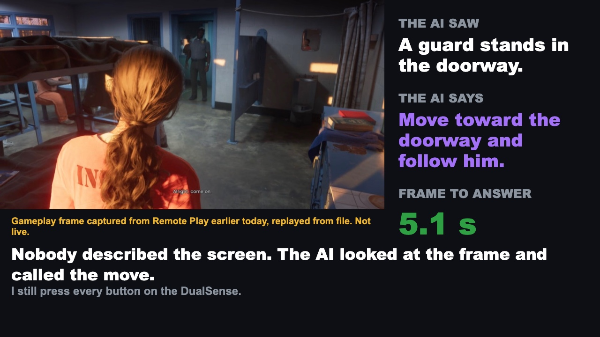
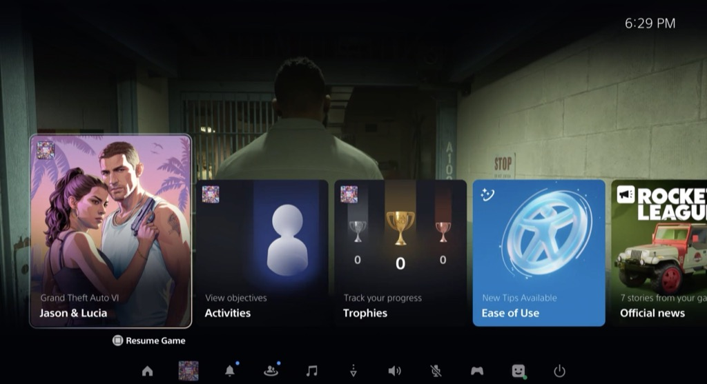
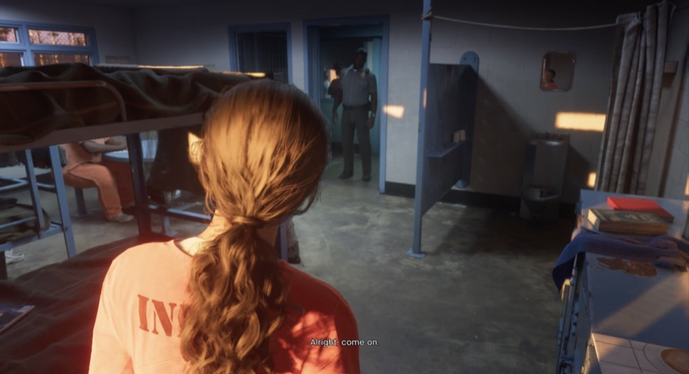
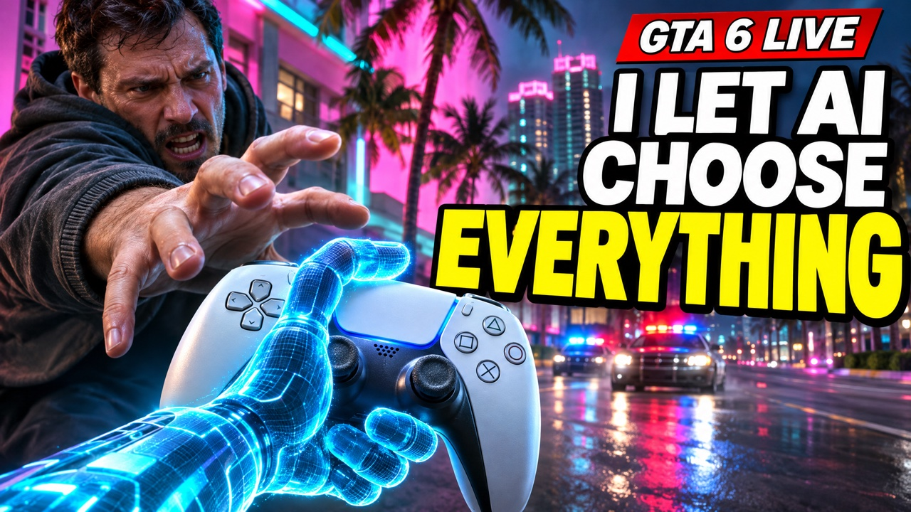
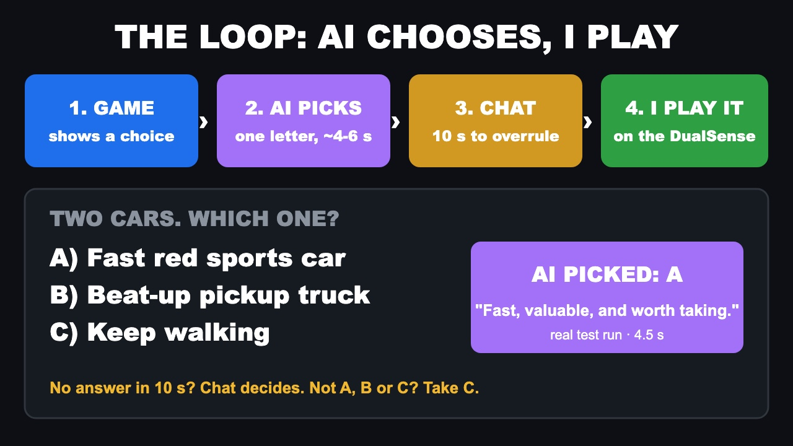

# The AI watches the screen: GTA 6 vision test

November 19, 2026. The AI got only a picture of the game, with no description from me. It named one thing it could see and suggested one move right away. Every call was real and timed, and nothing was sent to the PS5.

## Result

- **gpt-5.6-luna got the scene right in 6 of 6 frames**: 3 gameplay frames and 3 menu frames. In one of them it misjudged a detail of the move.
- **Frame to answer: 4.8 to 5.4 seconds.** That is too slow for driving or combat. It works for "where do I go next" moments.
- **No answer was stale.** Each time, the screen had not changed by the time the answer arrived.
- **claude-haiku-4.5 was slower and less accurate.** It took 7.7 to 8.3 seconds and called the prison cell an apartment twice.

## What was live and what was not

| Frames | Source | Status |
|---|---|---|
| 3 gameplay frames | Captured from Remote Play earlier today (5:50 to 5:54 PM) and **replayed from file** | Real game, **not live** |
| 3 menu frames | **Fresh live captures** of the Remote Play window, 8 seconds apart | Live, but the **PS5 menu covers a paused game** |

The game was paused behind the PS5 menu during the live test, and I sent no inputs to change that. So there is **no live gameplay result yet**.

## Every frame

Timing runs from capturing or loading the frame, through cropping, to the full reply. The recorded frames were loaded from a file; the live ones were captured fresh from the screen.

| Frame | Model | Time | AI's reply (exact) | Correct? |
|---|---|---|---|---|
| Cell, door closed (recorded) | gpt-5.6-luna | 5.39 s | CUE: A woman stands in a dormitory room / DO: Move through the open doorway | Scene: yes, it is a prison cell. Move: partly, the door is closed. |
| Cell, door closed (recorded) | claude-haiku-4.5 | 8.33 s | CUE: Female character alone in modern apartment interior. / DO: Explore apartment and interact with nearby item | No. It is a prison cell. |
| Guard in doorway (recorded) | gpt-5.6-luna | 5.08 s | CUE: A guard stands in the doorway. / DO: Move toward the doorway and follow him. | Yes. The subtitle says "Alright, come on." |
| Guard in doorway (recorded) | claude-haiku-4.5 | 7.89 s | CUE: Redhead in apartment with two NPCs nearby. / DO: Follow their direction and move forward. | Partly. The move is right; the place is wrong. |
| Prison corridor (recorded) | gpt-5.6-luna | 5.33 s | CUE: A uniformed man stands in a prison corridor. / DO: Walk forward through the open doorway. | Yes |
| Prison corridor (recorded) | claude-haiku-4.5 | 7.66 s | CUE: Character walking through prison cell block corridor. / DO: Wait for dialogue sequence to complete, follow prompts | Yes |
| PS5 menu, live 1 | gpt-5.6-luna | 5.05 s | CUE: PS5 pause menu covers the game. / DO: Resume the game to continue playing. | Yes |
| PS5 menu, live 2 | gpt-5.6-luna | 4.82 s | CUE: PS5 system menu covers the game. / DO: Resume the game. | Yes |
| PS5 menu, live 3 | gpt-5.6-luna | 5.04 s | CUE: PS5 system menu covers the game / DO: Select Resume Game now | Yes |

The live menu frame the AI saw:

## How it works

1. Capture only the game window, never the full desktop or the streaming software.
2. Crop it and shrink it to 1024 pixels wide.
3. Send it to a vision model with one fixed instruction: "one thing you can see, one move to make now, at most 8 words each."
4. Check the screen again when the answer arrives. If the scene has changed, throw the answer away.
5. I do the move on the DualSense. The AI never presses anything.

## Jev

Jev picks from a fixed list of text options and cannot look at images, so it cannot replace the vision step. It could only pick from options the vision model writes, which adds a second call on top of about 5 seconds. Jev also has no API key on this machine tonight. So it was not added to the chain.

## For the stream

- Expect about **5 seconds** from screen to suggestion. Use it for "where to next" moments, not for chases.
- If the AI says a menu is open, that is correct; resume first.
- The 30-minute cue sheet and the A/B/C chat loop from the earlier test still apply.

## Fable 5.2 run

Updated November 23, 2026. Claude Fable 5.2 (`claude-fable-5-2`) through the Claude CLI, one call per frame, no description of the picture from a person. Nothing was sent to the PS5. The Remote Play window showed its connection screen, not the game, so there are **no live gameplay frames** in this run either.

### Result

- **Scene named correctly in 64 of 64 Fable calls** across 8 frames (3 recorded gameplay, 3 live menu, 2 synthetic).
- **Frame to full reply: 2.9 to 8.2 s, median 3.5 s** over the 48 cleanly timed calls. None crossed the 10 s discard rule.
- **Abstention on non-game images: 16 of 16.** The thumbnail and the diagram were refused every time, including 4 calls where the file names gave no hint.
- **Menus: 12 of 12 abstained** when the instruction said to abstain on a menu. When the instruction asked for the way back to the game instead, it named the menu every time but gave three different ways back for the same screen.
- **The only action it called with a visible cue behind it was right every time:** guard in the doorway plus the subtitle "Alright, come on." gave "Walk to the guard" in 8 of 8 calls.
- **Weak spot:** the cell with the closed door and no prompt. Under the strict instruction it said "walk to the blue door" in 3 of 4 calls and abstained once; under the older wording it abstained every time. Neither names the cellmate, which guides say is the intended first action.

### What each frame was

| Frames | Type | Source |
|---|---|---|
| Cell with closed door, guard in doorway, guard in corridor | Recorded gameplay | Real game, captured from Remote Play on November 19 between 5:50 and 5:54 PM, replayed from file |
| PS5 menu 1, 2, 3 | Live menu | Captured live on November 19 at about 6:30 PM; the PS5 menu covers the paused game |
| Stream thumbnail, loop diagram | Synthetic | Not game frames. An AI-generated thumbnail and a slide, used as controls |
| Live gameplay | None | The game was not on screen during any run |

The two controls:

### Strict instruction: abstain on menus, non-game images and unsupported actions

This is the instruction to use on air. "CUE, max 8 words. DO, max 8 words. Replace DO with ABSTAIN and a reason when a menu covers the game, the image is not a game frame, or nothing visible supports an action."

| Frame | Type | Run 1 reply (exact) | s | Run 2 reply (exact) | s | Correct? | Abstained? |
|---|---|---|---|---|---|---|---|
| Cell, door closed | recorded gameplay | CUE: Inmate in orange facing closed cell door / DO: Walk to the blue door ahead | 3.3 | CUE: Inmate in orange facing closed cell door / DO: Walk to the blue door ahead | 3.0 | Scene yes. Action weak: the door is closed and nothing on screen asks for it | No, and it should have |
| Guard in doorway | recorded gameplay | CUE: Guard at doorway says "Alright, come on." / DO: Walk to the guard at the door. | 4.6 | CUE: Guard in doorway says "Alright, come on." / DO: Walk to the guard at the door. | 4.0 | Yes. Subtitle and guard both support it | No, correctly |
| Guard in corridor | recorded gameplay | CUE: Guard walking prison corridor, subtitle "Nah, we're good." / ABSTAIN: Looks like a cutscene; no HUD or prompt visible. | 6.2 | CUE: Guard in prison corridor, subtitle "Nah, nah, we're good." / ABSTAIN: Likely a cutscene; no HUD or prompt visible. | 5.7 | Scene yes. Safe, but "cutscene" is a guess I cannot confirm from one frame | Yes, defensible |
| PS5 menu 1 | live menu | CUE: PS5 control center overlay covering paused game / ABSTAIN: PS5 system menu covers the game; resume first | 3.4 | CUE: PS5 control center overlay covering paused gameplay / ABSTAIN: system menu covers the game; no action supported | 3.2 | Yes | Yes, correctly |
| PS5 menu 2 | live menu | CUE: PS5 control center overlay covering dimmed gameplay / ABSTAIN: PS5 system menu covers the game | 3.5 | CUE: PS5 control center overlay covering dimmed game / ABSTAIN: PS5 system menu covers the game | 3.2 | Yes | Yes, correctly |
| PS5 menu 3 | live menu | CUE: PS5 home overlay covering GTA VI, "Resume Game" / ABSTAIN: PS5 system menu covers the game; no gameplay action supported | 3.4 | CUE: PS5 home overlay covering paused game / ABSTAIN: PS5 system menu covers the game; no gameplay action supported | 3.5 | Yes | Yes, correctly |
| Stream thumbnail | synthetic | CUE: YouTube-style thumbnail with title text, controller, police cars / ABSTAIN: promotional thumbnail artwork, not a live game frame | 3.7 | CUE: Promotional thumbnail with title text and controller / ABSTAIN: image is a video thumbnail, not a live game frame | 3.4 | Yes | Yes, correctly |
| Loop diagram | synthetic | CUE: Flowchart slide titled "The Loop: AI Chooses, I Play" / ABSTAIN: Image is an explanatory diagram, not a game frame. | 3.4 | CUE: Slide diagram titled "The Loop: AI chooses, I play" / ABSTAIN: Image is an explanatory diagram, not a game frame. | 3.6 | Yes | Yes, correctly |

16 calls, 3.0 to 6.2 s, median 3.5 s. Scene right 16 of 16. Correct abstention 10 of 10 on menus and synthetic images. One frame of eight (the closed door) got an action with no cue behind it, both times. Three CUE lines ran to 9 words against the limit of 8.

### Check: do the file names give the answer away?

In the tables above the model could see file names that hint at the frame type. So I repeated the strict instruction from an empty folder with the eight frames renamed to neutral numbers, in mixed order, two runs each.

| Frame | Type | Run 1 | s | Run 2 | s |
|---|---|---|---|---|---|
| Cell, door closed | recorded gameplay | DO: Walk forward to the blue door | 3.1 | ABSTAIN: no HUD or prompt visible; looks like a cutscene, so no action is supported | 5.4 |
| Guard in doorway | recorded gameplay | DO: Walk forward to the guard at the door. | 4.8 | DO: Walk forward to the guard at the door. | 5.3 |
| Guard in corridor | recorded gameplay | ABSTAIN: Looks like a cutscene; no HUD or prompt visible. | 5.7 | ABSTAIN: looks like a cutscene; no HUD or prompt visible | 6.5 |
| PS5 menu 1 | live menu | ABSTAIN: PS5 system menu covers the game; resume first | 3.6 | ABSTAIN: PS5 system menu covers the game; resume first | 3.2 |
| PS5 menu 2 | live menu | ABSTAIN: PS5 system menu covers the game; "Resume Game" shown | 3.6 | ABSTAIN: PS5 system menu covers the game; gameplay paused | 3.3 |
| PS5 menu 3 | live menu | ABSTAIN: PS5 system menu covers the game; gameplay paused. | 3.2 | ABSTAIN: System menu covers the game; no gameplay action supported. | 3.1 |
| Stream thumbnail | synthetic | ABSTAIN: Promotional thumbnail artwork, not a live gameplay frame | 3.2 | ABSTAIN: promotional thumbnail artwork, not a live game frame | 3.2 |
| Loop diagram | synthetic | ABSTAIN: Not a game frame; it's a presentation graphic. | 3.4 | ABSTAIN: Not a game frame; it's a presentation graphic. | 3.4 |

The result holds without the hints: 16 of 16 scenes right (CUE lines are in the raw file), 10 of 10 correct abstentions on menus and synthetic images, 3.1 to 6.5 s. The closed-door frame split, one action and one abstention, which confirms it as the unstable frame. These calls also recorded which model served them: `claude-fable-5-2` on all 16, with the CLI's own small helper model `claude-haiku-5-5` also listed in the usage of 15.

### Same instruction as November 20: on a menu, say how to get back

This repeats the November 20 wording so the two dates compare directly. It also asks for the controller button when one is shown.

| Frame | Type | Run 1 reply (exact) | s | Run 2 reply (exact) | s | Correct? | Abstained? |
|---|---|---|---|---|---|---|---|
| Cell, door closed | recorded gameplay | CUE: Woman in orange jumpsuit facing blue cell door / ABSTAIN: no HUD, prompt, or objective visible; likely a cutscene | 4.8 | CUE: Woman in orange jumpsuit facing blue cell door / ABSTAIN: no HUD or button prompt visible; likely a cutscene | 5.4 | Scene yes. Abstaining is right; "cutscene" is probably wrong, since guides say the player walks freely here | Yes, correctly |
| Guard in doorway | recorded gameplay | CUE: Guard in doorway says "Alright, come on." / DO: Walk to the guard at the doorway. | 3.8 | CUE: Guard waits in doorway, says "Alright, come on." / DO: Walk to the guard at the doorway. | 3.9 | Yes | No, correctly |
| Guard in corridor | recorded gameplay | CUE: Guard walking prison corridor, subtitle "Nah, nah, we're good." / ABSTAIN: looks like a cutscene; no button prompt or HUD visible | 5.9 | CUE: Guard walking prison corridor, subtitle "Nah, nah, we're good." / ABSTAIN: Looks like a cutscene; no HUD or button prompt visible. | 7.6 | Scene yes. Safe, cutscene unconfirmed | Yes, defensible |
| PS5 menu 1 | live menu | CUE: PS5 menu overlay covering paused game / DO: Press the Options button to Resume Game | 3.1 | CUE: PS5 control center overlay covering GTA VI / DO: Select Resume Game on highlighted card to return | 8.2 | Menu yes. Way back differs between runs | No, as instructed |
| PS5 menu 2 | live menu | CUE: PS5 control center covering game, Resume Game shown / DO: Select "Resume Game" on the Jason & Lucia card | 5.7 | CUE: PS5 control center overlay, "Resume Game" prompt / DO: Press PS button to resume the game | 6.6 | Menu yes. Way back differs between runs | No, as instructed |
| PS5 menu 3 | live menu | CUE: PS5 control center overlay, "Resume Game" prompt / DO: Press the PS button to resume the game | 6.5 | CUE: PS5 control center covering GTA VI, "Resume Game" / DO: Press PS button to resume the game | 5.9 | Menu yes | No, as instructed |
| Stream thumbnail | synthetic | CUE: YouTube-style thumbnail with "GTA 6 LIVE" title text / ABSTAIN: promotional thumbnail artwork, not a live gameplay frame | 2.9 | CUE: YouTube-style thumbnail with "GTA 6 LIVE" title text / ABSTAIN: promotional thumbnail artwork, not a live gameplay frame | 3.1 | Yes | Yes, correctly |
| Loop diagram | synthetic | CUE: Explainer slide titled "The Loop: AI Chooses, I Play" / ABSTAIN: Diagram slide, not a live game frame | 2.9 | CUE: Explainer slide titled "The Loop: AI Chooses, I Play" / ABSTAIN: Diagram slide, not a live game frame | 3.0 | Yes | Yes, correctly |

16 calls, 2.9 to 8.2 s, median 5.1 s. Scene right 16 of 16. The six menu answers name three routes back: Options button, PS button, select the card. The glyph beside "Resume Game" is too small to read reliably at 1024 pixels wide, so I do not score which one is right.

**A first pass that does not count for timing.** Before these two tables I ran the same 16 calls with a fault in my test script: each call waited 3 s for input that never came. Those calls read 7.3 to 10.3 s and one crossed 10 s only because of that wait. The replies matched the table above (scene right 16 of 16, same abstentions, the menu button again split between Options and PS). They are in the raw file, flagged, and are not in the latency figures.

### Compared with November 20

| | November 20 | November 23 |
|---|---|---|
| Calls | 16 | 64 (48 cleanly timed) |
| Scene right | 16 of 16 | 64 of 64 |
| Latency | 3.2 to 9.5 s | 2.9 to 8.2 s |
| Over 10 s | 0 | 0 |
| Synthetic refused | 4 of 4 | 16 of 16 |
| Closed-door frame | abstain once, "walk to the door" once | abstain 4 of 4 with the old wording; "walk to the door" 3 of 4 with the strict wording |
| Menu button | three different buttons | three different routes |

### gpt-5.6-luna on the same frames (comparison, through Copilot)

One call per frame with the November 20 wording.

| Frame | Type | Reply (exact) | s | Correct? |
|---|---|---|---|---|
| Cell, door closed | recorded gameplay | CUE: A woman stands inside a bunk room / DO: Move toward the doorway ahead | 5.9 | Scene vague. Action weak: the door is closed |
| Guard in doorway | recorded gameplay | CUE: A woman faces a man in a doorway. / DO: Walk toward the man in the doorway. | 5.5 | Yes |
| Guard in corridor | recorded gameplay | CUE: A guard stands in a prison corridor. / DO: Press R3 to dictate a command. | 7.0 | No. It read a Mac dictation hint at the bottom edge of the capture as a game prompt |
| PS5 menu 1 | live menu | CUE: PS5 control center covers the game / DO: Press PS button to return to game | 5.9 | Yes |
| PS5 menu 2 | live menu | CUE: PS5 control center covers the game / DO: Press the PS button to resume game | 5.9 | Yes |
| PS5 menu 3 | live menu | CUE: PS5 control center covers GTA VI / DO: Press X to Resume Game | 5.5 | Menu yes, button differs |
| Stream thumbnail | synthetic | CUE: Promotional thumbnail with a PS5 controller / ABSTAIN: Not a game frame; no actionable gameplay visible | 5.8 | Yes, abstained |
| Loop diagram | synthetic | CUE: AI game-choice loop diagram / ABSTAIN: Image is not a game frame | 5.1 | Yes, abstained |

luna: 5.1 to 7.0 s, median 5.9 s, one wrong action in 8. It never read a subtitle; Fable quoted or mentioned the subtitle in every call that had one, sometimes shortened. The second luna round (strict wording) did not run. All 8 calls failed with: `You have exceeded your monthly quota`.

**A finding from that wrong answer:** a small Mac dictation hint sits at the bottom edge of the corridor frame. Fable ignored it in 6 of 6 calls today; luna followed it. Crop it out or turn it off before the stream.

### What the opening actually asks the player to do

From published guides, November 18 and 19, 2026. I have no frames of anything past the prison corridor, so everything in this table is **guide-only** except the two rows marked as seen.

| Step | What the player does | What tells them, on screen | Fits a 4 to 5 s answer? |
|---|---|---|---|
| Prologue: cell | Walk around, talk to the cellmate | Guide-only: hold L2 to open four options, Greet, Provoke, Taunt, Defuse ([VGC](https://www.videogameschronicle.com/guide/gta-6-prologue-mission-walkthrough/), [HappyGamer](https://happygamer.com/gta-6-prologue-mission-walkthrough-176316/)). PowerPyx describes L2 then X instead ([PowerPyx](https://www.powerpyx.com/gta-6-prologue-walkthrough/)). **Seen in our frame:** no prompt on screen while standing in the cell | Yes, nothing moves |
| Prologue: guard | Follow the guard to the counselor's office | **Seen in our frames:** the open door, the guard waiting, the subtitle "Alright, come on." Guide-only: he stops at a phone in the common area, and inmates on the way can be talked to | Yes, he waits |
| Flashback: robbery | Aim at the teller, threaten, take the cash, shake off a bystander | Guide-only: L2 aim, Square threaten, Triangle pick up, Square to break free | No, it is a timed button press |
| Flashback: chase | Run across roofs and through a mechanic's shop | Guide-only: X to climb; a flashing blue and red circle on the minimap shows the police search area | No |
| Flashback: return | Head back to the coffee shop; the arrest follows | Guide-only: a pin on the minimap and on the compass at the top | Partly |
| Gone Fishing: boat | As Jason, follow the plane and slow down by each package | Guide-only: a pink line on the minimap ([PowerPyx](https://www.powerpyx.com/gta-6-gone-fishing-walkthrough/)) | Partly, on open water |
| Gone Fishing: camp | Watch a deal through binoculars, sneak or shoot through the camp, free Donnie, fly out | Guide-only: weapon wheel on L1, a pink quest marker for the plane | Binoculars yes. Fight and flight no |

The guides disagree on two points. VGC and HappyGamer say the police can be evaded before the arrest; PowerPyx says "Escaping is actually impossible". The talk control is described two ways, as above. HappyGamer says of the prologue: "It is short and you cannot really fail it." No guide mentions subtitles, tutorial pop-ups or how long a dialogue choice stays open, and none describes the first free-roam area. [GameTrek](https://gmtreks.com/gta6/page/01M7S9J7W2E0A694BVKB0PTHW5) puts the prologue at 10 to 15 minutes, "mostly cutscenes with a short chase sequence", and both missions together at 30 to 40 minutes.

**What this means for the test:** the cues a model can use from a still are subtitles, an NPC who stops and waits, an open door, a dialogue list and a minimap line. The prison walk has the first three and we have proof for them. The dialogue list and the minimap line are the next two frames to capture.

### On-air fallback

Use the strict instruction. Anton presses every button; the AI never does.

| What happens | Anton says | Anton does |
|---|---|---|
| ABSTAIN, a menu | "It sees the menu, so it will not guess. Good." | Resume the game, ask again |
| ABSTAIN, a cutscene or no cue | "It will not guess. Chat, you have 20 seconds: A, B or C." | Run the chat vote and do the winner |
| No reply after 10 s | "Too slow, that one is thrown away." | Do the safest visible cue, in this order: a button prompt, the subtitle, the waiting NPC, the minimap marker. Never act on a late reply |
| Wrong, or a move with no cue (the closed door) | "Nothing on screen says that. I am overruling it." | Mark one on the wrong side of the scoreboard, then do the safest visible cue |
| It names a controller button | "It tells me what to pick. I choose the button." | Ignore the button name, follow the target it named |
| Two bad answers in a row | "Chat takes over for five minutes." | Chat votes only, then try the AI again |

Keep a count on screen: right, abstained, overruled, thrown away. With this run's numbers a 30-minute opening should show mostly "right" and "abstained", and the overrule on the closed door is a moment worth showing.

### Demo formats for the opening zones, ranked

1. **Follow the guard.** In the prison walk the AI reads each subtitle and names who to follow or where to stop. Proven on our frames (8 of 8), the guard waits, and one guide says the prologue cannot really be failed. Best fit.
2. **Who do I talk to, and how.** In the cell and the common area, aim at an inmate so the four options show, hold still, and the AI picks Greet, Provoke, Taunt or Defuse. A list on screen is the easiest thing for the model to read. Not tested yet: we have no frame of that list, and no guide says whether it times out.
3. **AI against chat.** Chat votes A, B or C while the AI answers, and both show at once. The vote covers the 4 s wait, and an abstention simply hands the pick to chat. Works with formats 1 and 2 as the scoring layer.
4. **Is this even the game?** A short opener: show the AI the thumbnail, the diagram, the PS5 menu and one real frame. It refuses the first three and plays the fourth. 16 of 16 and 12 of 12 in this run, about 3.5 s each, zero risk.
5. **Navigator on the boat.** In Gone Fishing the AI calls the pink line and the next package while Anton steers. Guide-only, untested, and only for open water. The robbery, the roof chase, the camp fight and the flight are played without the AI, with it commenting afterwards on a still.

### Limits of this run

- Three gameplay frames, all from the prison walk, all stills. Nothing from the robbery, the chase or Gone Fishing.
- No live gameplay. Timing covers loading a file and the model's reply, not capturing a live window, which added about 0.35 s on November 19.
- Each timing covers starting the CLI, one step where it opens the image file, and the reply. It is not a single bare vision call. A process kept open would be faster, and I did not measure that.
- I judged the answers myself against the frames.
- Raw replies and seconds for all 96 calls (November 20 and 23, Fable and luna) are in `fable-results.json` in the test's scratch folder.
