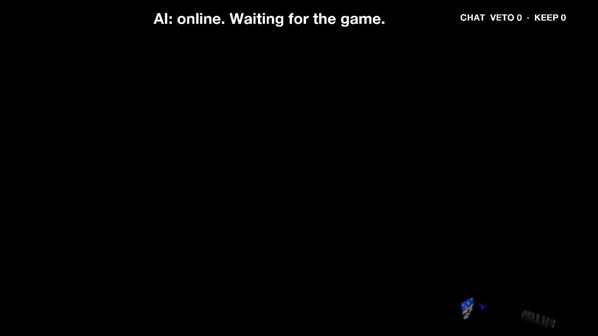

# AI Runs My Life in GTA 6: the script, checked line by line

**What changed in version 2:** I checked each line of the first script against what is built and tested. I built the parts that were missing: the live AI caller, the on-screen AI line, the Twitch vote counter and a capture fix. I cut or reworded every promise the stream can't keep. Each beat below is marked **Tested** (works today), **Built, not tested live** (works on saved frames, the dry run proves it) or **Your call live** (it depends on what happens).

## What to focus on today

Start at **12:00 PM ET**, which is when YouTube is scheduled. Plan to stream until about 4 PM.

1. **Before noon, on M5:** connect Remote Play and do a 5-minute dry run that isn't live, with one AI line on screen. Nothing else matters more.
2. **On air:** read every AI line out loud and do it. The show is you reacting to the AI, so talk the whole time.
3. **Chat:** point at the VETO count often, and when VETO wins, make a moment of it.
4. **Clips:** press Clip in Twitch on the button prompt, the arrest and any wrong AI call.

**How the stream is built:** PS5 to PS Remote Play on M5. OBS captures the Remote Play window and your camera. OBS sends the stream to Twitch, and the obs-multi-rtmp plugin sends it to YouTube and X. `ai-call.py` takes a screenshot of the game about every 20 s, asks Claude (Fable 5.2) for one move and writes it to the OBS text "AI Call". `chat-vote.py` reads Twitch chat and writes VETO/KEEP to "Chat Votes".

## What the show really is

The AI watches the game window. About every 20 seconds it puts one decision on screen, "AI: …" with a one-line "WHY: …". You play it. Twitch chat can type **VETO** or **KEEP**, and the count updates on screen. If VETO wins, you do the opposite and say so. YouTube and X chat can't be counted automatically, so read them out loud.

You hold the controller the whole time. The AI never presses a button.

## Line-by-line check of the first script

| First script said | Real? | Version 2 |
|---|---|---|
| AI makes every call, on screen | **Built and tested.** `ai-call.py` captures the Remote Play window, asks Fable 5.2, and writes to OBS; 3.3 to 5.2 s a call on saved frames | Kept |
| Chat can overrule: type VETO | **Built, Twitch only.** `chat-vote.py` read 281 real chat lines in 25 s; one vote per person, reset on each AI call | Kept for Twitch; YouTube and X read aloud |
| Score overlay, AI vs chat | Not possible: you can't update it while holding the pad | **Cut.** Keep score out loud, if at all |
| "Loser picks my next stream" | Not decided by you | **Cut** |
| Lucia's cell, crossword "planet of love" | **Already played.** Yesterday's save is past it: the last frame (5:55 PM) is the corridor behind the guard | **Cut** |
| Guard: "Alright, come on" | Tested: the AI got it right every time | Opener, **only if** the game resumes there |
| AI stays quiet in cutscenes | Tested: it says "watching…" | Kept |
| "The AI told me to rob a store" | False: the robbery is the story | **Reworded:** "The story makes me rob it. The AI just calls how." |
| Ask the AI which button for the prompt | Impossible: a call takes 3 to 5 s, the prompt lasts about 1 s | **Reworded:** "The AI is too slow for this, that's why I hold the pad." |
| "The AI got me arrested in 20 minutes" | False: the arrest is scripted | **Reworded:** "Scripted arrest. Even the AI can't talk me out of it." |
| "Next stream, the AI holds the controller" | Not built: Remote Play ignores the keyboard | **Cut.** Ask chat instead: "Should the AI get the controller one day? YES or NO." |
| 5 clips cut the same day | Twitch saves the broadcast for 7 days and clips are on (checked in settings); no ffmpeg here | Clip in Twitch: Clip That while live, or from the saved broadcast |
| Times like 0:04, 0:12 | Guesses | Now marked as order, not minutes |
| Thumbnail text "AI: ROB THE STORE?" | The AI never says it | **Cut.** New thumbnail with Anton's real face: `2026-11-19-gta6-live/thumb-real-G2.jpg` ("I LET AI RUN MY LIFE", GTA 6 LIVE). kie-B is retired (not Anton) |

## Where the game is

Yesterday's last frames show Lucia walking the prison corridor behind the guard, with the game suspended on the PS5 home screen (0 trophies). If the PS5 kept it suspended, you resume right there. If the PS5 closed it, you load the last autosave, probably the same corridor or the cell. The beats after the corridor come from guides (games.gg, Fextralife), not our play: counselor cutscene, robbery flashback, a button prompt, a police chase and an unavoidable arrest.

**Do not start a new game:** it could overwrite yesterday's progress.

## The script, in order

Times are rough. Follow the game, not the clock.

| # | On screen | You say or do | Status | Clip? |
|---|---|---|---|---|
| 1 | Starting Soon, then the game | "Everyone's playing GTA 6. I'm letting an AI run my life in it. It watches my screen and calls every move, up there. I hold the controller. Twitch chat: type VETO and I do the opposite." | Your call live | Hook |
| 2 | First AI line appears | Read it out. Do it. "That's the AI. Every 20 seconds, one decision." | Built, not tested live | |
| 3 | Corridor, guard (if you resume there) | AI: "Follow the guard." "Easy one, robot." | Tested on this exact scene | |
| 4 | Cutscene | AI shows "watching…". "It knows when to shut up. Unlike you, chat." | Tested | |
| 5 | Counselor cutscene | 30 seconds on how it works: "Screenshot in, three to five seconds, one move out. It runs on my Claude plan." | True: measured | LinkedIn clip |
| 6 | Robbery flashback | "Story time: Lucia robs a store. Not the AI's idea. But it'll tell me how." Read its lines. | Your call live | Clip |
| 7 | Button prompt | Press it yourself. "The AI takes four seconds. That prompt gave me one. This is why I hold the pad." | Fact: measured speed | Clip |
| 8 | Police chase | Let the late AI lines show. "The AI is five seconds behind, it's narrating the past." | Built, behaviour live | Clip |
| 9 | Arrest | "Scripted. Even the AI can't talk me out of it." | Fact from guides | Clip |
| 10 | After the Prologue | Now real choices: where to go, whom to talk to. Point at the VETO count. If VETO wins, do the opposite: "Chat overruled the machine." | Built; votes depend on viewers | Clip |
| 11 | End | "Should the AI get the controller one day? YES or NO in chat." Read the answers, thank people, raid or end. | Your call live | |

**When the AI fails:** it shows "no signal, I'm on my own". Say "the AI rage-quit" and keep playing. When it's wrong, that is the clip: read it out and do the right thing.

## Clips (vertical, cut in Twitch)

Make them only if the moment happens. Each title must match what is in the clip.

| Moment | Title | When it's honest |
|---|---|---|
| Button prompt | The AI is too slow for GTA 6 | Always: speed measured |
| Chase, late lines | My AI narrates GTA 6 five seconds late | If the lines show up late on screen |
| Arrest | Even the AI couldn't stop this arrest | Always: scripted |
| VETO wins | My chat overruled the AI in GTA 6 | Only if a VETO really wins |
| Worst call | The AI's worst call in GTA 6 | Only for a real wrong call |

## Run sheet, before going live

| # | Step | Who | Status |
|---|---|---|---|
| 1 | Twitch title "I Let AI Run My Life in GTA 6 (Chat Can Overrule It) 🔴" | Done by me, checked after a reload | Done |
| 2 | OBS: "AI Call" and "Chat Votes" text in scene "PS5 Remote Window", top of screen, clear of the minimap | Done by me, screenshot above | Done |
| 3 | On M5: open PS Remote Play, connect to the PS5, full screen as yesterday | You | |
| 4 | Point the OBS game capture at the new Remote Play window (its id changes each launch) | Me: `fix-capture.py`, or you re-pick the window in OBS | Tested |
| 5 | Start the AI: `python3 ai-call.py --every 20 --max 25` | Me, or you in Terminal | Tested on saved frames |
| 6 | Start votes: `python3 chat-vote.py aabyzov` | Me, or you | Tested on live chats |
| 7 | 5-minute dry run, not live: one AI line on screen while the game runs | You and me | Not done |
| 8 | YouTube: new title, description and the G2 thumbnail on the 12:00 PM scheduled stream. On M5: X key check, caffeinate | Me (YouTube, checked on the public page); you (X, caffeinate) | YouTube done |
| 9 | Posts | You approve, I post | Drafts ready |

Commands run from `~/.specwithcode/m4/scratch/2026-11-20-gta6-viral/`. `touch pause.flag` pauses the AI; delete the file to resume.

## Limits to say out loud or keep in mind

- **Usage:** 25 AI calls on your Claude plan, which hit its limit on November 19. The loop stops at 25 and shows "out of calls for today".
- **Spoilers:** Prologue first; say "Prologue spoilers" in the description.
- **Votes:** Twitch only.
- **Nobody can promise viral.** This bets on record GTA 6 demand, a proven "chat controls the game" format, and AI behaviour we measured.

Nothing was posted or streamed. The first version is kept at `~/.specwithcode/m4/scratch/2026-11-20-gta6-viral/script-v1.md`.

Designed page: `2026-11-20-gta6-ai-runs-my-life-viral-script.html` in this folder.
