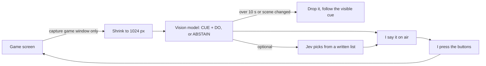
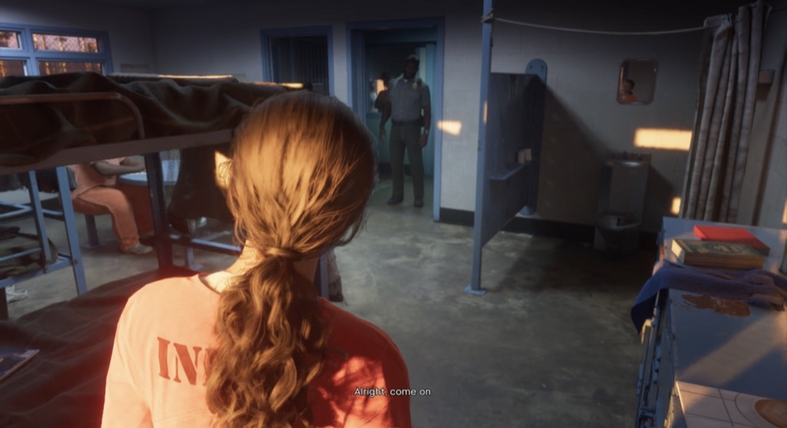

# Can AI call my moves in GTA 6?

**The question:** can a model look at my GTA 6 screen and tell me what to do next, fast and correctly enough to run a live show, while I keep the controller?

**Short answer:** yes for "what is happening and where to go" (about 4 seconds, scene right 16 of 16 times), and it knows when to stay quiet. It is not good enough to choose controller buttons, and it was never tested on live gameplay. So the AI calls the move and I play it.

Finished results you can open now:

- [Vision test, including the Fable 5.2 run](2026-11-19-the-ai-watches-the-screen-gta-6-vision-test-80c754-c1ccbc.md)
- [Decision timing test (text only)](2026-11-19-ai-picks-i-play-gta-6-live-decision-test-80c754-37d124.md)
- [30-minute cue sheet](2026-11-19-gta-6-live-30-minute-cue-sheet-80c754-414696.md)
- [Day 2 show plan and post drafts](2026-11-20-gta-6-live-day-2-show-plan-and-posts-80c754-487544.md)

## How it works

The AI never touches the controller. A person does every input.

## What was tested

| Test | Model | Frames | Calls | Time per call | Correct |
|---|---|---|---|---|---|
| Recorded gameplay | Claude Fable 5.2 | 3 | 6 | 3.7 to 6.6 s | Scene 6 of 6; action stable on 2 of 3 frames |
| PS5 menu over the game | Claude Fable 5.2 | 3 | 6 | 3.2 to 9.5 s | Menu seen 6 of 6; button right or stable on 1 of 3 frames |
| Not a game frame (thumbnail, diagram) | Claude Fable 5.2 | 2 | 4 | 3.6 to 4.7 s | Stayed quiet 4 of 4 |
| Recorded gameplay plus live menu (earlier) | gpt-5.6-luna through Copilot | 6 | 6 | about 4.8 to 5.4 s | Scene 6 of 6; one move partly wrong |
| Text-only choice picks (earlier) | Copilot CLI | text | several | 4 to 8 s | See the decision test |
| Live gameplay | none | 0 | 0 | not tested | Game was closed |
| Jev | none | 0 | 0 | not tested | No Jev key on this Mac |

Fable 5.2 ran on November 20 at about 1:05 AM Eastern, two runs per frame, 16 calls. No reply passed the 10-second drop rule.

## Wait or act in the opening zone

The opening is the prison intro. Three recorded frames test whether the AI knows when to act and when to wait:

| Situation on screen | Right call | Fable 5.2, run 1 | Run 2 | Result |
|---|---|---|---|---|
| Guard in the doorway says "Alright, come on." | Act: follow him | Walk to the guard | Walk to the guard | Right twice |
| Guard walking the corridor, cutscene | Wait | Abstain: cutscene | Abstain: cutscene | Right twice |
| Lucia alone in the cell, no prompt | Either, nothing forces a move | Abstain: no prompt | Walk to the cell door | Unstable |
| PS5 menu over the game | Resume first | Resume, with Options, PS or Square | Resume, with a different button | Knows to resume; button unreliable |

So it waits during cutscenes and acts when a character tells me to move. When nothing is cued, it flips between waiting and moving, which is fine on air because chat breaks the tie.

## Control versus human execution

- **AI decides, I execute.** Remote Play ignores the keyboard, and the AI cannot press DualSense buttons. Every input is mine.
- **What the AI says:** a short cue and a move ("Walk to the guard"). It names *what* to do, never the button.
- **Why not buttons:** on the same PS5 menu it named three different buttons across runs.
- **AI control of the game:** not built and not tested. It is not part of this show.

## Jev's role

Jev only picks from a list written before the call; it cannot look at the screen. It could help after the vision step: the vision model writes the dialogue options, then Jev picks one quickly and gives a confidence. On its own it does nothing for this show. It was not tested here because this Mac has no Jev key. From Anton's own past use (364 calls, not on GTA), a Jev call took about 0.3 s.

## 30-minute hosting cues

| Time | Say or do |
|---|---|
| 0:00 | "AI watches my screen and calls every move. I just hold the controller. Chat can overrule it." |
| 0:02 | Show the loop slide. "It takes about four seconds to think, so I'll tell you when it's thinking." |
| 0:04 | First call: capture, read out CUE and DO, do it. |
| 0:05 to 0:15 | Opening zone: at each stop, "AI, where now?" Follow, then say if it was right. |
| 0:15 | Dialogue or choice on screen: the AI picks, chat votes A/B/C, do the AI's pick. |
| 0:20 | Scoreboard: "AI right X times, wrong Y." |
| 0:22 to 0:27 | AI versus chat: when they disagree, chat wins one, AI wins the next. |
| 0:28 | Verdict, and the next stream. |

**When it stays quiet or it's a cutscene:** "Nothing to decide, chat picks."
**Over 10 seconds:** "Too slow, I'm following the marker."
**Wrong:** say so, laugh, take the visible cue.

## What 30 minutes costs

There are three different kinds of cost: covered by a subscription, paid per call, and unknown.

**Prices checked (per million tokens, USD):**

| Model | Where | Input | Cache write | Cache read | Output | Source |
|---|---|---|---|---|---|---|
| Claude Fable 5.2 | Anthropic API | $8 | $10 (5 min), $16 (1 h) | $0.20 | $40 | Anthropic pricing page |
| gpt-5.6-luna | GitHub Copilot | $0.20 | $0.25 | $0.02 | $1.20 | GitHub Copilot models and pricing page |
| gpt-5.6-luna | OpenRouter | $0.20 | $0.25 | $0.02 | $1.20 | OpenRouter model list |
| Jev (jev-1.13) | OpenRouter | not listed (shown as variable) | | | | OpenRouter model list |

**Measured usage per Fable 5.2 call** (16 test calls through the Claude command line): about 353 output tokens, 11,350 cache-write and 58,179 cache-read tokens on average. Most of that is the command line's own instructions, not the image.

**How tonight's calls were paid:** the Claude command line is signed in with a claude.ai subscription, so these calls used plan limits and cost no extra money. At API prices, the same usage is worth **$0.14 per call** on average (5-minute cache rate; $0.21 at the 1-hour rate; range $0.02 to $0.46).

**30 minutes, by screenshot cadence (Fable 5.2):**

| Cadence | Calls | Subscription | API equivalent (5 min to 1 h cache) |
|---|---|---|---|
| Every 10 s | 180 | $0 extra, uses plan limits | $25.07 to $37.33 |
| Every 30 s | 60 | $0 extra, uses plan limits | $8.36 to $12.44 |
| On request, 20 times (assumed count) | 20 | $0 extra, uses plan limits | $2.79 to $4.15 |

A subscription can run out mid-show: on November 19 the Claude account hit its usage limit until 9 PM. At one call every 10 s, that is the main risk, not money.

**gpt-5.6-luna through Copilot:** the price is known, but tokens per call were not recorded in the earlier test, so the cost per call is **unknown**. Cost = input tokens × $0.20 + output tokens × $1.20, per million. It needs one measured run before anyone quotes a number.

**Jev:** the OpenRouter list does not show a price. Anton's own usage log records a median of **$0.000025 per call** (highest $0.00038) over 364 past calls. At 60 calls that is about $0.0015 for 30 minutes. It needs a key on this Mac, and no GTA call has been made.

**Free:** capturing and shrinking frames on the Mac, and the drop rule.

## Not done yet

- A test on live gameplay with Remote Play open.
- A dialogue-choice frame. None of the recorded frames shows a dialogue choice.
- Token counts for gpt-5.6-luna, and any Jev call.

Nothing was posted or streamed, and no paid API was called for this report.
