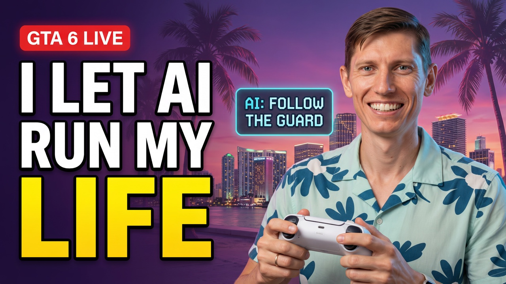

# GTA 6 live, day 2: show plan and posts

**The show:** AI reads my screen and calls my moves in GTA 6. I hold the controller and do what it says. Chat can overrule it.

## Title

I Let AI Run My Life in GTA 6 (Chat Can Overrule It) 🔴 (set on Twitch November 20, 1:47 AM)

The show order below is version 1. Use the [checked script](2026-11-20-ai-runs-my-life-in-gta-6-the-script-and-the-vira-80c754-845f05.md) instead.

## Opening (say this first)

"Yesterday I gave AI the controller in GTA 6, well, almost. Today it goes further: it watches my screen, and every time there's a choice, a door, a dialogue line or a direction, it makes the call and I play it. It takes about four seconds to decide, so I'll tell you when it's thinking. If you think it's wrong, vote in chat and we'll see who's better at GTA, you or the AI."

## What I show, in order (about 60 minutes)

| Time | Segment | What the AI does |
|---|---|---|
| 0:00 | Opening and the rule | Nothing yet; show the thumbnail loop slide |
| 0:03 | Dialogue and choice calls | Reads each dialogue or choice on screen and names the pick (best format: the 4 s delay does not matter) |
| 0:15 | Where to next | At each stop, names the door, NPC or direction to follow |
| 0:30 | AI versus chat | AI picks, chat votes A/B/C, I play the winner; keep score |
| 0:45 | Shops, outfits, menus | Picks items from static menus |
| 0:55 | Verdict and wrap | Who won, AI or chat; tease the next stream |

## What was tested and how well

- **Screen reading (Claude Fable 5.2, tonight):** right scene in 16 of 16 calls, about 4 s each (3.2 to 9.5 s). It correctly says nothing on cutscenes and non-game images.
- **Earlier model (gpt-5.6-luna):** 6 of 6 scenes, about 5 s.
- **Menus:** it always knows a PS5 menu is open and says "resume the game", but it names the wrong controller button half the time. So it says *what* to pick; I press the button.
- **Not tested:** live play (the game was closed tonight) and Jev, which has no API key on the M5. Jev can only pick from a written list of options, so it could add value for dialogue picks once the screen model has written the options, not on its own.
- Full results: [vision test](2026-11-19-the-ai-watches-the-screen-gta-6-vision-test-80c754-c1ccbc.md).

## When the AI fails on air

- **Says nothing or it's a cutscene:** "Nothing to decide, chat picks."
- **Takes over 10 s:** drop it and follow the visible cue.
- **Wrong:** say so, laugh, do the visible cue. It is part of the show.

## Before going live

1. **On M5:** open OBS. Check profile **GTA6 Twitch** and scene **GTA 6 Live**, then open Docks > Multiple output and see **X @aabyzov** and **YouTube** listed.
2. **On M5:** open PS Remote Play, start the game, and check the game shows in the OBS preview (the window changes id each launch, so reselect it in the GTA Remote Play source if it is black).
3. **On M5:** in YouTube Studio, set the title above. On X, check the stream key still works (it is from the last X stream).
4. **On M5:** hide the Wispr Flow bubble, move the Dock off the game screen, and keep the Mac awake (`caffeinate -s -t 14400` in Terminal).
5. **On M5:** approve the posts below, then press Start Streaming in OBS.

## Posts (drafts, version 2, nothing posted)

Rewritten for the new title. Every claim matches the [checked script](2026-11-20-ai-runs-my-life-in-gta-6-the-script-and-the-vira-80c754-845f05.md): the AI calls the moves, I hold the controller, and Twitch chat can veto.

**X**

> Live at 12 ET: I'm letting AI run my life in GTA 6.
>
> It watches my screen and puts every decision up top. I hold the controller and do it.
>
> Twitch chat can type VETO and I do the opposite. 🔴

**LinkedIn**

> Today at 12 PM ET I'm streaming GTA 6 with an AI calling my moves.
>
> A vision model looks at the game window, and three to five seconds later its decision is on screen. I hold the controller and carry it out.
>
> What testing on recorded frames showed:
> - It read the scene right 16 out of 16 times.
> - It stays quiet in cutscenes and menus.
> - It is too slow for button prompts, so a human stays on the controller.
>
> AI decides, a human executes and checks. Same split I use at work. Twitch, YouTube or X.

**Threads**

> AI runs my life in GTA 6 today. 🎮
>
> It watches my screen and calls every move. I just play it. Twitch chat can veto it.
>
> Live at 12 ET.

**Telegram (Russian)**

> Сегодня в 12:00 по Нью-Йорку (20:00 МСК) стрим GTA 6.
>
> ИИ смотрит на экран и принимает решения за меня, а я играю. Чат на Twitch может написать VETO, и я сделаю наоборот.
>
> Twitch, YouTube и X.

**Twitch and YouTube community post**

> Live at 12 ET: AI runs my life in GTA 6. Type VETO in Twitch chat to overrule it.

All posts use the thumbnail above. Version 1 is kept at `~/.specwithcode/m4/scratch/2026-11-20-gta6-viral/posts-v1.md`.
